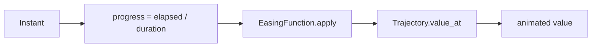

# smearor-commons-animation

Timed animations, pure `std`: a `TimedAnimation` pairs a `Trajectory` —
the shape of the animated output — with a `Duration` and an
`EasingFunction`.

## What's inside

- [Clock](./animation/clock.md) — `TimedAnimation` lifecycle: start,
  progress, `value_at`, the `Option` state machine
- [Trajectories](./animation/trajectories.md) — `Span`,
  `ThreePhaseSpan`, tuple composition, the ready-made aliases
- [Interpolation](./animation/interpolation.md) — the `Interpolate`
  contract per type, shortest-arc `RotationRad`, unclamped `t`
- [Easing](./animation/easing.md) — all eight `EasingFunction` curves
  with their exact formulas
- [Rotation Snap](./animation/rotation-snap.md) — `RotationSnap`
  gesture sessions: engage at 10°, snap at 45°, `SnapUpdate` events
- [GTK Driver](./animation/gtk-driver.md) — `drive()` on a widget's
  frame clock

The crate splits an animation into three independent halves: a
`Trajectory` says *what* changes, `Interpolate` says *how values* move,
and `EasingFunction` says *how time* moves — compose them freely.
See the crate's rustdoc for the full API.
