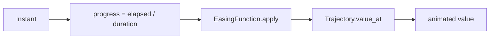

# smearor-commons-animation

Timed animations, pure `std`: a `TimedAnimation` pairs a `Trajectory` —
the shape of the animated output — with a `Duration` and an
`EasingFunction`.

## Trajectories compose

- `Span<T>` interpolates between two values of any `Interpolate` type
  (scalars, `Vec2`, `RotationRad` shortest-arc, `ScaleFactor`).
- `ThreePhaseSpan<T>` eases out, holds and eases back.
- `(S1, S2)` tuples animate composite values on one clock — "rotate
  while zooming" needs no dedicated animation struct.

Ready-made aliases: `RotationAnimation`, `ZoomAnimation`,
`PulseAnimation`, `Vec2Animation<U>`, `RotationZoomAnimation`.

## Easing

`EasingFunction`: `Linear`, `EaseIn`, `EaseOut`, `EaseInOut`,
`EaseInCubic`, `EaseOutCubic`, `EaseInOutCubic` and `Overshoot`
(Penner's canonical `s = 1.70158` via `EasingFunction::overshoot()`).

## Rotation snapping

`RotationSnap` tracks a gesture rotation and reports `SnapUpdate`s when
the angle crosses snap/direction/feedback thresholds — haptics-friendly
rotation snapping without a dedicated state machine per consumer.

## GTK4 driver

The `gtk4` feature adds `drive`, which pumps a `TimedAnimation` on a
widget's frame clock. `schemars` schema derives live behind their
feature gate. See the crate's rustdoc for the full API.
