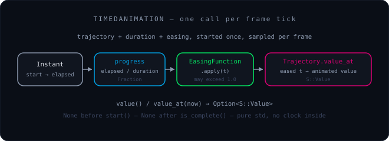

# Clock

`TimedAnimation<S>` is the crate's central type: a `Trajectory` (the
shape of the output), a `Duration` and an `EasingFunction` — **pure
`std`**, no frame clock inside. The consumer samples it once per frame
tick.

<figure class="diagram">
  
  <figcaption>started once, sampled per frame — None outside the running window</figcaption>
</figure>

## Lifecycle

```rust
use smearor_commons_animation::{Span, TimedAnimation, EasingFunction};
use smearor_commons_geometry::{Pixels, ScaleFactor};
use std::time::Duration;

let mut animation = TimedAnimation::new(
    Span::new(ScaleFactor::new(1.0), ScaleFactor::new(1.5)),
    Duration::from_millis(250),
    EasingFunction::EaseOutCubic,
);

animation.value();          // None — not started yet
animation.start();          // captures Instant::now()
animation.value();          // Some(…) — eased position on the span
animation.is_complete();    // true once elapsed >= duration
animation.value();          // None — the animation is over
```

`start_at(instant)` substitutes the clock — deterministic tests, or
aligning several animations to one tick. `progress()` /
`progress_at(now)` expose the raw `Fraction` when a consumer needs it
(e.g. drawing a countdown arc alongside the animated value).

## `Option` is the state machine

`value_at` returns `None` before `start()` and `None` after
completion — a polling consumer needs no separate state tracking:

```rust
match animation.value() {
    Some(value) => widget.apply(value),
    None if animation.is_complete() => finish(),
    None => {}                          // not started
}
```

The `gtk4` feature's `drive()` wraps exactly this pattern in a widget
tick callback — see [GTK Driver](./gtk-driver.md).
