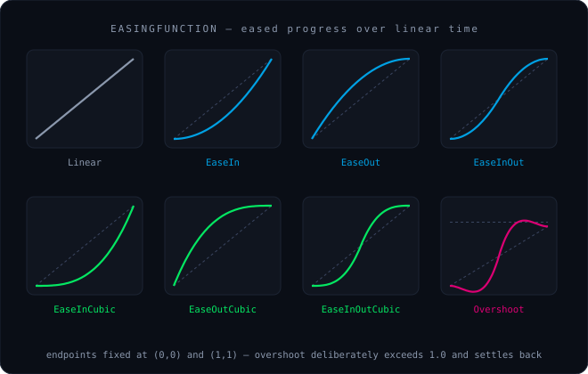

# Easing

`EasingFunction` maps linear time progress to eased progress —
`apply(t)` turns a constant-speed clock into acceleration curves. All
endpoints are fixed at `(0, 0)` and `(1, 1)`; what happens between is
the curve's personality.

<figure class="diagram">
  
  <figcaption>the exact formulas from easing.rs — overshoot, back and elastic deliberately exceed 1.0</figcaption>
</figure>

```rust
use smearor_commons_animation::EasingFunction;
use smearor_commons_geometry::Fraction;

EasingFunction::Linear.apply(Fraction::HALF);          // 0.5 — constant speed
EasingFunction::EaseOutCubic.apply(Fraction::HALF);    // 0.875 — the arrive curve
EasingFunction::overshoot().apply(Fraction::HALF);     // 0.5 — below 0 before, past 1 after
```

## The power family — `Ease{In,Out,InOut}` × `{Quad,Cubic,Quart,Quint}`

Each degree sharpens the curve; every variant comes in three
directions:

- **Quadratic**: `EaseIn` (`t²`), `EaseOut`, `EaseInOut`
- **Cubic**: `EaseInCubic`, `EaseOutCubic` — the classic "arrive"
  curve for camera and pose transitions — `EaseInOutCubic`
- **Quartic**: `EaseInQuart`, `EaseOutQuart`, `EaseInOutQuart` (`t⁴`)
- **Quintic**: `EaseInQuint`, `EaseOutQuint`, `EaseInOutQuint` (`t⁵`)

## The trigonometric families

- **Sine** — `EaseInSine`, `EaseOutSine`, `EaseInOutSine`: the
  gentlest curves
- **Exponential** — `EaseInExpo`, `EaseOutExpo`, `EaseInOutExpo`:
  near-frozen start, abrupt end
- **Circular** — `EaseInCirc`, `EaseOutCirc`, `EaseInOutCirc`:
  quarter-circle arcs

## Beyond the endpoints

- **`Overshoot { overshoot_amount }`** — Penner's back-in-out:
  `EasingFunction::overshoot()` is the canonical `s = 1.70158`.
- **`BackIn` / `BackOut { overshoot_amount }`** — the two halves:
  dip below the start / overshoot the target.
- **`Elastic { amplitude, period }`** — oscillates around the target
  and settles; the springy classic.
- **`Bounce`** — decreasing parabolic bounces into the target.

Eased `t` exceeding `[0, 1]` is a feature, not a bug: see
[Interpolation](./interpolation.md) for how value types handle
extrapolation.

## `CubicBezier { x1, y1, x2, y2 }` — CSS-compatible custom curves

The `cubic-bezier()` function from CSS, verbatim: `y` may exceed
`0..1`, `x` is clamped to it. `CubicBezier { x1: 0.25, y1: 0.1, x2:
0.25, y2: 1.0 }` is CSS `ease`; `(0.42, 0.0, 0.58, 1.0)` is
`ease-in-out`. Designers hand you four numbers — this variant runs
them.

## `Steps { steps, jump }` — discrete easing

Quantizes the progress into `steps` jumps, CSS `steps()` compatible:
`StepsJump::End` jumps at each interval's end (the last at `t = 1`),
`StepsJump::Start` at its start (the first at `t = 0`). For stepping
the *value* instead of the progress see `trajectory::Steps`.

## Playground

`cargo run -p smearor-commons-animation --features gtk4 --example playground`
— pick a trajectory and an easing, tune overshoot, amplitude, period,
steps, bezier points and duration with sliders, watch the curve and
the animated value on the frame clock.
