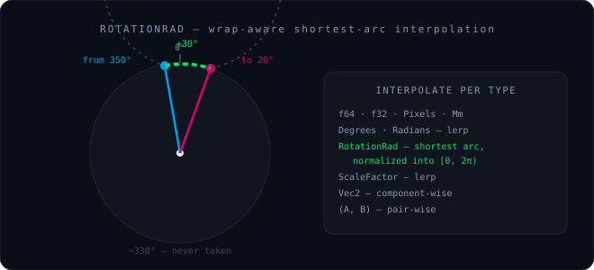

# Interpolation

`Interpolate` is the value-level contract: `interpolate(self, target,
t)` — where `self` lands at `t = 0`, `target` at `t = 1`. `Span` builds
its `Trajectory` impl on it; consumers can implement it for their own
value types.

<figure class="diagram">
  
  <figcaption>RotationRad interpolates on the shortest arc — it never sweeps the long way</figcaption>
</figure>

## Implementations

| Type | Semantics |
|---|---|
| `f64`, `f32` | plain lerp |
| `Pixels`, `Millimeters` | lerp inside the newtype |
| `Degrees`, `Radians` | lerp — scalar units, not rotations |
| `RotationRad` | **shortest arc**, normalized into `[0, 2π)` |
| `ScaleFactor` | `ScaleFactor::lerp` |
| `Vec2<U, T>` | component-wise — both axes on one clock |
| `(A, B)` | pair-wise — composite values |

## `t` is not clamped

Easing curves like `Overshoot` deliberately produce `t > 1.0`, and each
type decides what extrapolation means:

- plain scalars just keep going past the target
- `RotationRad` keeps turning past the target on the shortest arc and
  settles back — an overshooting rotation swing, exactly what a
  spring-loaded tile feels like

## `Radians` vs. `RotationRad`

A deliberate distinction from the geometry crate: `Radians` is a
*scalar* (angles as measurements — interpolate linearly, `30° →
390°` is 360° of travel), while `RotationRad` is an *orientation*
(`350° → 20°` is `+30°` of travel across the wrap). Animating
orientations should always go through `RotationRad`.
