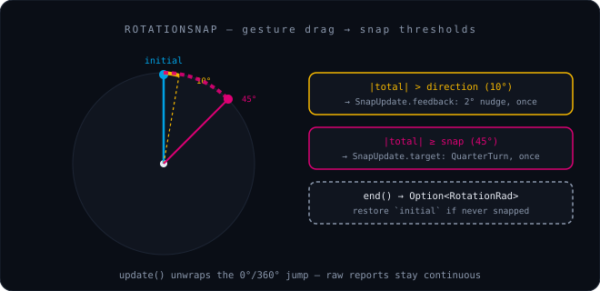

# Rotation Snap

`RotationSnap` is the haptics-friendly part of the crate: it tracks a
rotate gesture's cumulative angle and reports when the drag crosses
engagement and snap thresholds — so consumers snap a tile to the next
`QuarterTurn` without a state machine of their own.

<figure class="diagram">
  
  <figcaption>engage at 10°, snap at 45° — each event fires at most once per session</figcaption>
</figure>

## Session lifecycle

```rust
use smearor_commons_animation::RotationSnap;
use smearor_commons_geometry::RotationRad;

// gesture begin: capture the tile's current rotation
let mut snap = RotationSnap::new(current_rotation);

// per gesture report — the cumulative angle since gesture begin
let update = snap.update(reported_angle);
if let Some(feedback) = update.feedback {
    tile.rotation += feedback;          // the 2° engagement nudge
}
if let Some(target) = update.target {
    tile.snap_to(target);               // QuarterTurn — gesture settles
}

// gesture end — restore the nudge if the drag never snapped
if let Some(restore) = snap.end() {
    tile.rotation = restore;
}
```

## Three stages per drag

1. **Below `direction`** (default `10°`) — nothing happens; small
   wobbles are ignored.
2. **Crossing `direction`** — the drag direction locks (clockwise vs.
   counter-clockwise) and `SnapUpdate.feedback` emits a one-shot `2°`
   nudge in that direction — the "engagement" haptic.
3. **Crossing `snap`** (default `45°` — `Degrees::EIGHTH_TURN`) —
   `SnapUpdate.target` emits the `QuarterTurn` the gesture settles on,
   computed via `QuarterTurn::snap_target(initial, direction)`. The
   session freezes; further `update()`s return empty `SnapUpdate`s.

Both fields can fire in one `update` — a drag jumping straight past
the snap threshold still emits `feedback` first, preserving the
"nudge, then snap" order.

`update()` unwraps the `0°`/`360°` boundary per report before
accumulating — raw gesture angles jump `±360°` there while the drag
itself is continuous.

## `end()` is the undo path

`end()` yields `Some(initial)` when the drag never snapped — restoring
`initial` also undoes the feedback nudge the consumer applied
mid-drag. It returns `None` once a snap target was emitted: nothing to
restore, the new quarter turn stays.

`with_thresholds(initial, snap, direction, feedback)` overrides all
three defaults (`DEFAULT_SNAP`, `DEFAULT_DIRECTION`,
`DEFAULT_FEEDBACK`) for consumers that want tighter or looser snapping.
