# Trajectories

A `Trajectory` maps eased progress `t` to a value — **the shape of an
animation's output over time**. Time lives in `TimedAnimation`; the
trajectory only knows how to answer `value_at(t)`.

<figure class="diagram">
  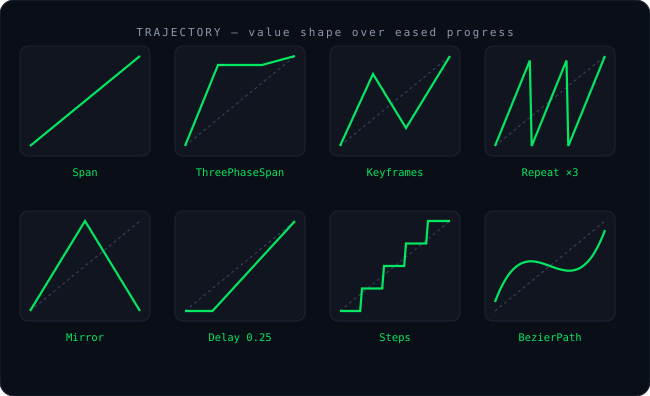
  <figcaption>one tile per trajectory — value over progress</figcaption>
</figure>

## `Span<T>` — two endpoints

  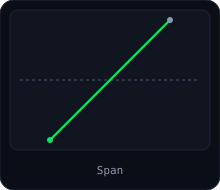


```rust
use smearor_commons_animation::{Span, Trajectory};
use smearor_commons_geometry::{Fraction, Pixels, Vec2};

let span = Span::new(0.0_f64, 100.0);
span.value_at(Fraction::HALF);          // 50.0

// any Interpolate type — positions move both axes on one clock
let slide = Span::new(Vec2::<Pixels>::new(0.0, 0.0), Vec2::<Pixels>::new(320.0, 0.0));
```

## `ThreePhaseSpan<T>` — out, hold, back

  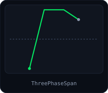


`new(from, mid, to, lead, trail)`: interpolates `from → mid` over
`[0, lead)`, holds `mid` over `[lead, trail]`, interpolates `mid → to`
over the rest.

<figure class="diagram">
  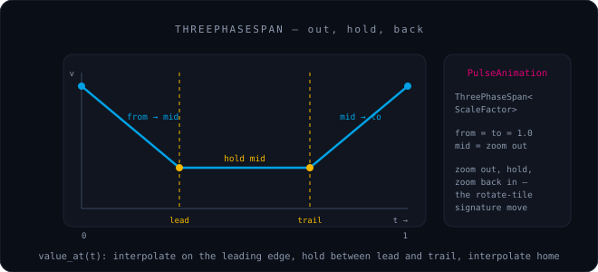
  <figcaption>the pulse shape — zoom out, hold, zoom back in</figcaption>
</figure>

`ThreePhaseSpan<ScaleFactor>` with `from = to = 1.0` is the
zoom-during-rotation pattern; `PulseAnimation` is exactly that.

`with_easing(lead_ease, trail_ease)` shapes the interpolation
*inside* the lead and trail phases - the boundaries stay real time
fractions while each phase gets its own curve. Without it the outer
`TimedAnimation` easing warps the phase durations along with
everything else.

`with_hold(hold_to, hold_ease)` turns the hold into a drifting
phase: instead of sitting at `mid` it eases `mid -> hold_to` over
the hold duration - a slow settle or a breathing pause.

`with_hold_mode(.., HoldMode::Pulse)` mirrors the hold curve
`0 -> 1 -> 0`: the excursion peaks mid-hold and returns to `mid` -
an animation around the hold point that hands off cleanly to the
trail phase. `Elastic` as hold easing turns it into an
oscillation.

## `Keyframes<T>` — the general case

  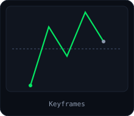


`(progress, value)` pairs, piecewise-lerped, boundary values holding
outside the range. `Span` is two keys, `ThreePhaseSpan` is four —
every other shape is a special case of this one:

```rust
use smearor_commons_animation::{Keyframes, Trajectory};
use smearor_commons_geometry::Fraction;

let keys = Keyframes::new(
    (Fraction::ZERO, 0.0_f64),
    [(Fraction::new(0.3), 0.8), (Fraction::new(0.6), 0.2), (Fraction::ONE, 1.0)],
);
keys.value_at(Fraction::new(0.45));     // lerps between the two middle keys
```

The first key is a separate argument — a `Keyframes` can never be
empty.

## `Repeat<S>` — the same cycle, `n` times

  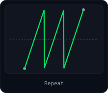


Wraps an inner trajectory and plays it `count` times within the
duration — blinking, pulsing, loading indicators. Easing applies to
the whole sequence, not per cycle:

```rust
use smearor_commons_animation::{Repeat, Span};

let blink = Repeat::new(Span::new(0.0_f64, 1.0), 3); // three cycles
```

## `Mirror<S>` — yo-yo

  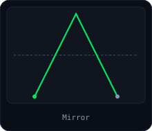


`0 → 0.5` plays `inner` forward, `0.5 → 1` plays it backward —
`A → B → A` on one clock. `Mirror` inside `Repeat` is a seamless
back-and-forth.

## `Delay<S>` — choreography

  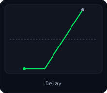


Holds `inner`'s start value until progress `delay`, then plays the
inner trajectory compressed into the rest. In a tuple composite this
staggers the members: `(Span<RotationRad>, Delay<Span<ScaleFactor>>)`
rotates first, zooms after, on one clock.

## `Eased<S>` — a local easing decorator

  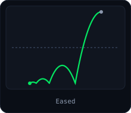

`Eased::new(inner, easing)` applies an `EasingFunction` to the
progress *inside* a trajectory — `value_at(t) =
inner.value_at(easing(t))`. That frees easing from the clock:
`TimedAnimation` can run `Linear` while each component of a
composite animation (a tuple, a split axis) keeps its own curve.

```rust
use smearor_commons_animation::{Eased, EasingFunction, Span};

let bounced = Eased::new(Span::new(0.0, 1.0), EasingFunction::Bounce);
```

## `Steps<T>` — discrete values

  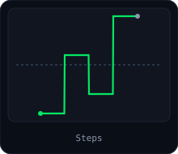


`values` held in order, `1 / n` progress each — no interpolation.
Typewriter reveals, frame animation. For stepping *before* the
trajectory sees the progress use `EasingFunction::Steps` instead.

## `BezierPath<P>` — along a curve

  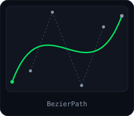


The value is the point on the bezier through `points` at `t` —
evaluated by recursive de Casteljau. Two points give a line, three a
quadratic, four a cubic. Generic over the point type:
`BezierPath<Vec2<Pixels>>` animates along screen curves,
`BezierPath<Vec3>` sweeps a spatial path — any `Interpolate` point
works.

```rust
use smearor_commons_animation::{BezierPath, Trajectory};
use smearor_commons_geometry::{Fraction, Vec3};

let swoop = BezierPath::new(
    Vec3::<()>::new(0.0, 0.0, 0.0),
    [Vec3::new(1.0, 2.0, 1.0), Vec3::new(2.0, 0.0, 0.5)],
);
swoop.value_at(Fraction::HALF);
```

## `Orbit<U>` — circular laps

  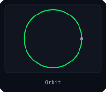


`Orbit::new(center, radius)` moves the value on a circle —
spinners, loading wheels. One lap by default; `with_turns(n)` runs
`n` revolutions per animation. Integer `turns` closes the curve, so
`value_at(0) == value_at(1)` — a seamless loop under
`EasingFunction::Linear`. Pair with `Mirror` for a partial swing.

```rust
use smearor_commons_animation::{Orbit, Trajectory};
use smearor_commons_geometry::{Fraction, Vec2};

let wheel = Orbit::new(Vec2::<()>::new(0.5, 0.5), 0.3).with_turns(2.0);
wheel.value_at(Fraction::new(0.25));    // south after half a lap
```

## `Helix<U>` — circular climb

  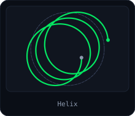


`Helix::new(center, radius, z_from, z_to)` is the spatial cousin of
`Orbit`: the value winds around `center` while `z` interpolates
linearly — corkscrews, ascending paths. `with_turns(n)` adds
windings.

```rust
use smearor_commons_animation::{Helix, Trajectory};
use smearor_commons_geometry::{Fraction, Vec2};

let corkscrew = Helix::new(Vec2::<()>::new(0.0, 0.0), 0.5, 0.0, 1.0);
corkscrew.value_at(Fraction::HALF);     // opposite point at z = 0.5
```

## `Lissajous<U>` — sinusoidal ratio figures

  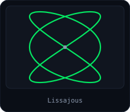


`Lissajous::new(center, size, x_turns, y_turns)` oscillates both
axes sinusoidally — `2:1` draws a figure eight, `3:2` a bow tie.
`with_phase` shifts the `x` wave and changes the handedness.
Integer ratios close the loop.

```rust
use smearor_commons_animation::{Lissajous, Trajectory};
use smearor_commons_geometry::Vec2;
use std::f64::consts::FRAC_PI_2;

let eight = Lissajous::new(Vec2::<()>::new(0.5, 0.5), 0.4, 2.0, 1.0)
    .with_phase(FRAC_PI_2);            // circle -> eight -> line
```

## `Spiral<U>` — winding out

  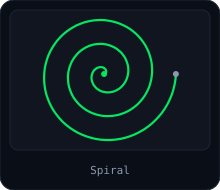


`Spiral::new(center, radius)` circles the center while the radius
grows linearly from `0` to `radius` — `with_turns` sets the
windings.

## `PolygonPath<P>` — edges in equal time

  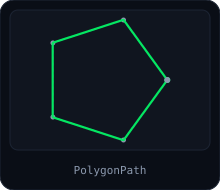


`PolygonPath::new(vertices)` travels a closed polygon — every
edge gets the same time share, corners stay corners. Generic like
`BezierPath`: `PolygonPath<Vec3>` walks a spatial polygon.

## `CatmullRom<P>` — through every point

  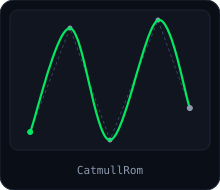


`CatmullRom::new(points)` draws the smooth spline that passes
through *all* its control points — unlike a bezier, every knob
lies on the curve. Same generic point type.

## `Lemniskate<U>` — the canonical eight

  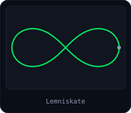


`Lemniskate::new(center, size)` traces the Bernoulli lemniscate —
the classic infinity shape, smooth through its crossing.

## `SphericalOrbit<U>` — a tilted lap

  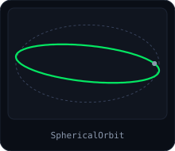


`SphericalOrbit::new(center, radius, inclination)` is `Orbit` with
the plane tilted by `inclination` radians — `0` is flat,
`FRAC_PI_2` a vertical wheel swinging through `z`.

## `TorusKnot<U>` — winding a torus

  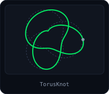


`TorusKnot::new(center, radius, p, q)` traces the (p,q) torus
knot — `p` winds around the axis, `q` threads the hole. Prime
pairs draw the interlaced classics, e.g. `(2, 3)` the trefoil.

## `Figure8<U>` — an eight with depth

`Figure8::new(center, size, depth)` draws a Gerono lemniscate in
the `x`/`y` plane that also swings `depth` units along `z` — an
infinity loop diving forward.

## `Ellipse<U>` — the oval lap

  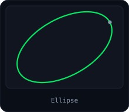


`Ellipse::new(center, rx, ry)` widens `Orbit` to independent
semi-axes; `with_rotation` tilts the axes, `with_turns` counts
laps.

## `Rose<U>` — the rosette

  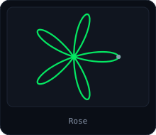


`Rose::new(center, size, petals)` traces `r = size·cos(k·θ)` —
`petals = 3` the trefoil rose, `4` an eight-leaf rosette.
`with_phase` rotates the figure.

## `Spiro<U>` — the spirograph

  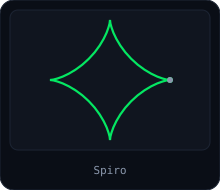


`Spiro::new(center, outer, inner, pen)` rolls a wheel `inner`
inside `outer` while a pen `pen` units out draws stars and
blossoms - `outer = 4·inner` with `pen = inner` gives the
four-cusped astroid.

## `Superellipse<U>` — exponent morphing

  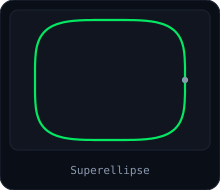


`Superellipse::new(center, rx, ry, exponent)` morphs with `n`:
`2` is the ellipse, `2/3` the astroid, large `n` a squircle.

## `StarPath<P>` — the star polygon

  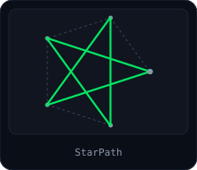


`StarPath::new(vertices).with_step(k)` is `PolygonPath` skipping
`k` vertices per edge - five points, `step = 2`: the pentagram.

## `WaveTrail<U>` — travel with wobble

  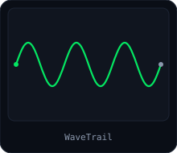


`WaveTrail::new(from, to, amplitude, waves)` moves `from -> to`
swaying perpendicular — a slalom across the field.

## `BouncePath<U>` — hops that decay

  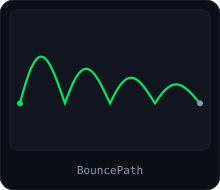


`BouncePath::new(from, to, height, hops, decay)` hops parabolas
along the route, each `decay` smaller than the last.

## `ConicalHelix<U>` — the tapering staircase

  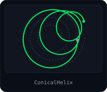


`ConicalHelix::new(center, r_from, r_to, z_from, z_to)` is `Helix`
with the radius growing or shrinking while it climbs — a spiral
staircase flaring into a cone.

## `Viviani<U>` — a figure eight on a sphere

  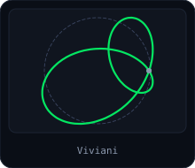


`Viviani::new(center, radius)` traces the intersection of sphere
and off-center cylinder — a closed lemniscate in space.

## `Mobius<U>` — the one-sided edge

  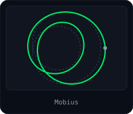


`Mobius::new(center, radius, width)` walks the single edge of a
Moebius strip — two ring revolutions to return, half a run flips
sides.

## `SphereLissajous<U>` — weaving a ball

  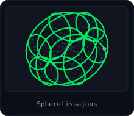


`SphereLissajous::new(center, radius, lon, lat)` oscillates
longitude and latitude in frequency ratio — woven basket coverage
of a sphere, closed for integer ratios.

## `Lorenz<U>` — the strange attractor

  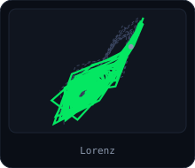


`Lorenz::new(center, size)` integrates the classic chaotic system
at construction and walks the baked path — the butterfly. It does
not close; `Mirror` makes it loop-friendly.

## Tuples — composite values on one clock

`(A, B)` implements `Trajectory` when both members do — a
rotate-while-zooming animation needs no dedicated struct:

```rust
use smearor_commons_animation::{Span, ThreePhaseSpan};
use smearor_commons_geometry::{RotationRad, ScaleFactor};

let trajectory = (
    Span::new(RotationRad::ZERO, RotationRad::QUARTER_TURN),
    ThreePhaseSpan::new(
        ScaleFactor::new(1.0), ScaleFactor::new(0.85), ScaleFactor::new(1.0),
        Fraction::new(0.3), Fraction::new(0.7),
    ),
);
// TimedAnimation<…>::value_at(t) → (RotationRad, ScaleFactor)
```

`Box<dyn Trajectory<Value = V>>` implements `Trajectory` too — a UI
can let the user pick the shape at runtime and run it on the same
clock.

## Ready-made aliases

| Alias | Type | For |
|---|---|---|
| `RotationAnimation` | `TimedAnimation<Span<RotationRad>>` | tile/pose rotation |
| `ZoomAnimation` | `TimedAnimation<Span<ScaleFactor>>` | plain zoom |
| `PulseAnimation` | `TimedAnimation<ThreePhaseSpan<ScaleFactor>>` | out-hold-back |
| `Vec2Animation<U>` | `TimedAnimation<Span<Vec2<U>>>` | position/size |
| `RotationZoomAnimation` | `TimedAnimation<(Span<RotationRad>, ThreePhaseSpan<ScaleFactor>)>` | the rotate gesture's full effect |

`Fraction::clamped` inside `ThreePhaseSpan::new` keeps
`lead ≤ trail` — phase order can not be inverted by accident.

## Playground

`cargo run -p smearor-commons-animation --features gtk4 --example playground`
opens a GTK window that combines any trajectory with any easing —
parameters (overshoot, elastic amplitude/period, steps, bezier
control points, repeat count, delay) are sliders, and the easing
curve is drawn behind the animated value.
