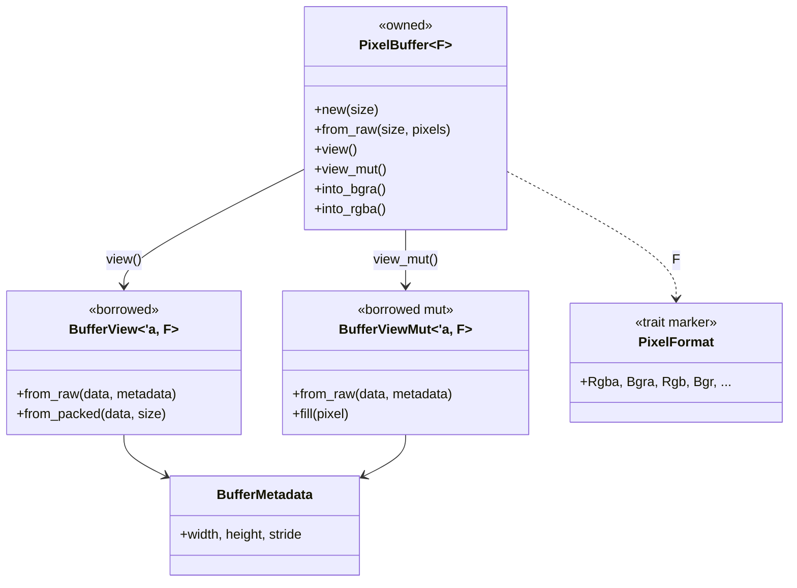

# smearor-commons-buffer

Pixel and graphics buffer types: ownership, format, extent and stride.

`smearor-commons-buffer` models the three questions every software
rasterizer has to answer: **what do the bytes mean** (the `PixelFormat`
marker types), **where do the rows live** (`BufferMetadata` +
`Stride`), and **who owns them** (`PixelBuffer` vs. the `BufferView`
borrow types).

- [Formats](./buffer/formats.md) — the nine `PixelFormat` markers and
  their byte layouts, plus the runtime `PixelFormatId` mirror
- [Layout](./buffer/layout.md) — `BufferMetadata`, `Stride`, packed
  vs. strided rows, offset math, `BufferError` validation
- [Views](./buffer/views.md) — `BufferView`/`BufferViewMut` over
  foreign memory: Wayland SHM, framework surfaces
- [PixelBuffer](./buffer/pixel-buffer.md) — the owned packed buffer
  and its in-place format conversions
- [GTK](./buffer/gtk.md) — the `gtk4` bridge: `MemoryFormat` mapping,
  `MemoryTexture` upload/download, image decode

Drawing operations live downstream (`smearor-commons-drawing`); framework
bridges (`image`, `cairo`, `gtk4`, `smithay`) are added behind
dependency-named features. See the crate's rustdoc for the full API.
