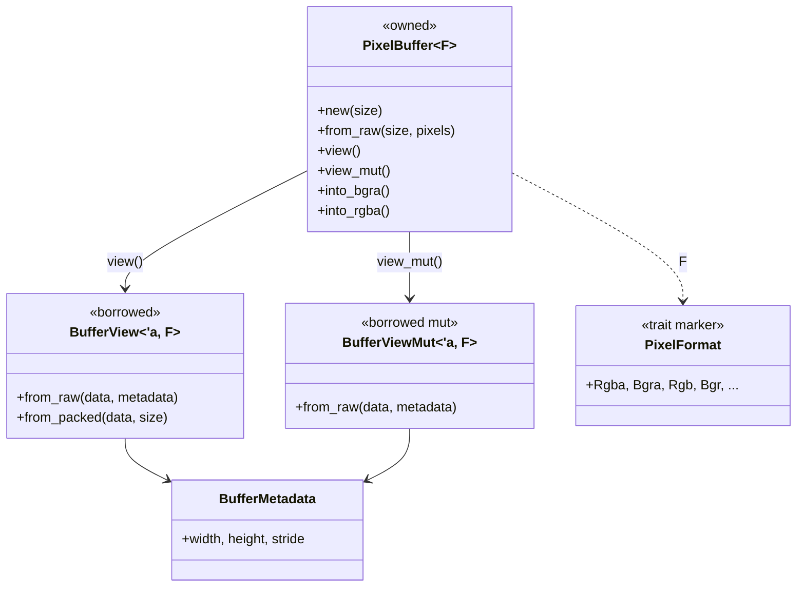

# smearor-commons-buffer

Pixel and graphics buffer types: ownership, format, extent and stride.

`PixelBuffer<F>` owns a packed pixel buffer; `BufferView` and
`BufferViewMut` borrow strided foreign memory (Wayland SHM, framework
surfaces). `BufferMetadata` carries the format-agnostic
width/height/stride triple. The pixel format is a type-level marker
(`Rgba`, `Bgra`, `Rgb`, `Bgr`, `Rgbx`, `Bgrx`, `Gray`) implementing
`PixelFormat`, so format mismatches are compile errors rather than
runtime checks.

Drawing operations live downstream (`pixel-drawing`); framework bridges
(`image`, `cairo`, `gtk4`, `smithay`) are added behind dependency-named
features. See the crate's rustdoc for the full API.
