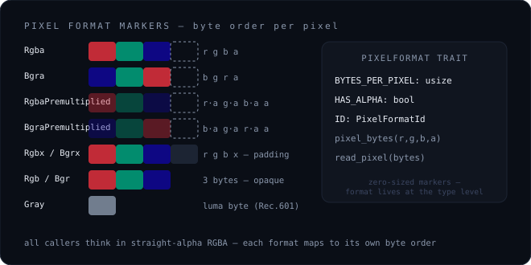

# Formats

The pixel format is a **type-level marker**, not a runtime flag.
`PixelBuffer<Rgba>` and `PixelBuffer<Bgra>` are different types — a
mismatch is a compile error, never a runtime check.

<figure class="diagram">
  
  <figcaption>nine markers — every caller thinks in straight-alpha RGBA</figcaption>
</figure>

## The `PixelFormat` trait

Implementors are zero-sized tags carried as `PhantomData`. The trait
anchors all channel knowledge on the format itself:

```rust
// const interface — no methods on values
F::BYTES_PER_PIXEL   // 4 | 3 | 1
F::HAS_ALPHA         // false for Rgb/Rgbx — padding is not alpha
F::ID                // PixelFormatId — the runtime mirror
```

`pixel_bytes(r, g, b, a)` encodes straight-alpha RGBA channels into
this format's byte order; `read_pixel` decodes back. Premultiplied
formats multiply/divide by alpha on the way in and out; alpha-free
formats read as opaque; `Gray` reduces to a Rec.601 luma
(`0.299·r + 0.587·g + 0.114·b` as fixed-point byte math).

## The nine markers

| Marker | Bytes | Alpha | Order |
|---|---|---|---|
| `Rgba` | 4 | yes | `r g b a` — the default (`PixelBuffer` without `F`) |
| `Bgra` | 4 | yes | `b g r a` — Wayland/cairo's favorite |
| `RgbaPremultiplied` | 4 | yes | `r·a g·a b·a a` |
| `BgraPremultiplied` | 4 | yes | `b·a g·a r·a a` — what `gdk_texture_download` yields |
| `Rgb` / `Bgr` | 3 | opaque | no alpha byte at all |
| `Rgbx` / `Bgrx` | 4 | ignored | 4th byte is padding, not a channel |
| `Gray` | 1 | opaque | single luma byte |

## PixelFormatId — the runtime mirror

`PixelFormatId` is the value-level enum of the same set —
`BYTES_PER_PIXEL`-style info at runtime (`bytes_per_pixel()`,
`has_alpha()`, `Display`) for diagnostics, wire formats and the GTK
`MemoryFormat` mapping:

```rust
use smearor_commons_color::Color;
use smearor_commons_buffer::{Bgra, PixelFormat, PixelFormatId};

let id = Bgra::ID;                        // PixelFormatId::Bgra
id.bytes_per_pixel();                     // 4
id.has_alpha();                           // true
format!("{id}");                          // "bgra"
```

The type-level marker and the runtime id are tied together by
`F::ID` — no way to declare one format and report another.
