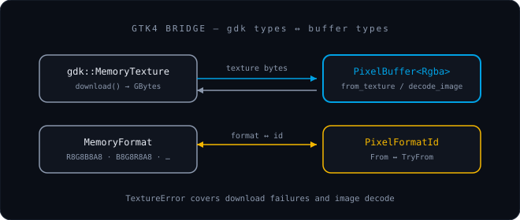

# GTK

The `gtk4` feature adds the two-directional bridge to gdk —
`smearor-commons` stays headless without it; with it, software-rendered
pixels go straight into widgets.

<figure class="diagram">
  
  <figcaption>formats map 1:1; texture pixels normalize to straight-alpha RGBA</figcaption>
</figure>

## Formats: `PixelFormatId ⇄ gdk::MemoryFormat`

Every 8-bit `PixelFormatId` has an exact `MemoryFormat` counterpart
(`R8g8b8a8`, `B8g8r8a8`, `G8`, …). The `From` direction is infallible;
`TryFrom<MemoryFormat>` hands back the format value when it hits a
16/32-bit or float layout with no commons counterpart.

## Upload: `to_memory_texture()`

On `PixelBuffer<F>` for **any** format — the texture gets `F::ID`'s
gdk equivalent and a copy of the packed bytes:

```rust
use smearor_commons_buffer::{PixelBuffer, Bgra};

let buffer = PixelBuffer::<Bgra>::new(size);
let texture = buffer.to_memory_texture();   // gdk::MemoryTexture — upload once
// picture.set_paintable(Some(&texture));
```

## Download: `from_texture()` & `decode_image()`

`gdk_texture_download` always yields `ARgb32` — premultiplied BGRA in
memory order — so `PixelBuffer::<Rgba>::from_texture` is infallible:
it unpremultiplies and reorders through the `PixelFormat` channel
interface, giving straight-alpha RGBA no matter what the texture stored.

`decode_image(bytes)` goes one step further — any image format gdk
understands (PNG, JPEG, …) becomes a `PixelBuffer<Rgba>`:

```rust
use smearor_commons_buffer::PixelBuffer;

let buffer = PixelBuffer::decode_image(&png_bytes)?;   // TextureError::Decode on failure
```

`TextureError` splits the two failure modes: `Decode(glib::Error)` for
undecodable image bytes, `UnsupportedFormat(MemoryFormat)` when a
texture memory format has no `PixelFormatId` — e.g. HDR float formats.
