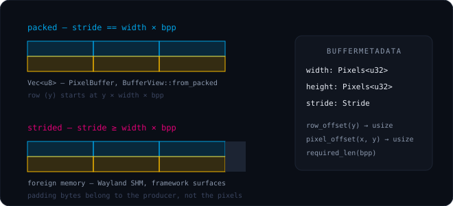

# Layout

`BufferMetadata` carries the format-agnostic geometry of a buffer:
`width` and `height` in `Pixels<u32>`, `stride` as a `Stride(pub u32)`
newtype — **bytes per row including padding**.

<figure class="diagram">
  
  <figcaption>stride is the producer's row length — pixels may end before the row does</figcaption>
</figure>

## Packed vs. strided

- **Packed** (`stride == width × bytes_per_pixel`) — what
  `PixelBuffer` allocates and what `BufferView::from_packed` expects:
  rows back to back, no gaps.
- **Strided** (`stride ≥ width × bpp`) — foreign memory from Wayland
  SHM pools, framework surfaces, GPU downloads. The padding belongs to
  the producer's alignment; the pixels end before the row does.

```rust
use smearor_commons_buffer::{BufferMetadata, Stride};
use smearor_commons_geometry::Pixels;

let packed = BufferMetadata::packed(Pixels::new(800), Pixels::new(480), 4);
packed.stride;          // Stride(3200) — public fields, no getters
```

```rust
use smearor_commons_buffer::{BufferMetadata, Stride};
use smearor_commons_geometry::Pixels;

// a Wayland SHM row of 800 BGRA pixels aligned to 3328 bytes:
let meta = BufferMetadata::new(Pixels::new(800), Pixels::new(480), Stride::new(3328));
meta.size();               // Size(800, 480)
meta.row_bytes(4);         // 3200 — the pixels' share of a row
meta.required_len(4);      // stride·(h-1) + row_bytes — minimal valid length
meta.is_packed(4);         // false — 3328 > 3200
meta.row_offset(Pixels::new(3));   // Some(3 × 3328)
meta.pixel_offset(Pixels::new(10), Pixels::new(3)); // Some(3·3328 + 10·4)
```

## Validation

`validate(bytes_per_pixel, data_len)` checks the whole contract before
a view wraps foreign memory, returning the dedicated `BufferError`
variants:

```rust
use smearor_commons_buffer::{BufferError, BufferMetadata, Stride};
use smearor_commons_geometry::Pixels;

let meta = BufferMetadata::new(Pixels::new(800), Pixels::new(480), Stride::new(3328));
meta.validate(4, 800 * 480 * 4)?;        // Ok
meta.validate(4, 100)?;                  // Err(BufferError::DataTooShort { .. })
```

| `BufferError` | Trigger |
|---|---|
| `LengthMismatch` | `PixelBuffer::from_raw` data ≠ `size.x·size.y·bpp` |
| `StrideTooSmall` | stride < packed row width — would drop pixels |
| `DataTooShort` | slice shorter than `required_len` — last row cut off |

The format is *deliberately absent* from `BufferMetadata` — it lives at
the type level on buffers and views, so a metadata struct stays
shareable across formats.
