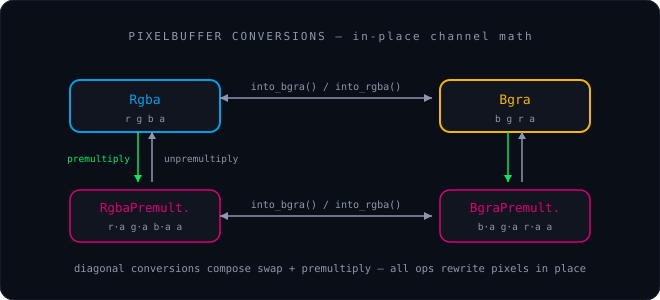

# PixelBuffer

`PixelBuffer<F>` owns its pixels: a packed `Vec<u8>` plus a
`Size<u32>`. `F` defaults to `Rgba`, so `PixelBuffer::new(size)` is an
RGBA buffer.

```rust
use smearor_commons_buffer::{PixelBuffer, Rgba};
use smearor_commons_geometry::Size;

let mut buffer = PixelBuffer::<Rgba>::new(Size::new(64, 64));   // zeroed, 16 KiB
buffer.width();        // Pixels(64)
buffer.area();         // Pixels(4096)
buffer.pixels_mut();   // &mut [u8] — write channels directly
buffer.is_zero();      // all-zero fast path (e.g. "nothing drawn yet")
```

`from_raw(size, pixels)` validates `pixels.len() ==
expected_len(size)` — otherwise `BufferError::LengthMismatch`.

## Views into the owned memory

`view()` / `view_mut()` lend the allocation to APIs that take
`BufferView`/`BufferViewMut` — drawing, for instance, never needs to
know whether it renders into an owned buffer or foreign memory.

## Format conversions — in place

Conversions rewrite the existing `Vec` and hand back the same bytes
retyped — no second allocation:

<figure class="diagram">
  
  <figcaption>channel swaps horizontally, alpha math vertically — compose freely</figcaption>
</figure>

```rust
use smearor_commons_buffer::{Bgra, BgraPremultiplied, PixelBuffer, Rgba};

let rgba = PixelBuffer::<Rgba>::new(size);
let bgra: PixelBuffer<Bgra> = rgba.into_bgra();                       // swap r/b
let pre: PixelBuffer<BgraPremultiplied> = bgra.into_premultiplied();  // c *= a
let back = pre.into_unpremultiplied().into_rgba();                    // full round-trip
```

- `into_bgra()` / `into_rgba()` — channel swaps, on both the straight
  and the premultiplied side
- `into_premultiplied()` / `into_unpremultiplied()` — multiply or
  divide the color channels by alpha (`a = 0` unpremultiplies to black,
  not to garbage)
- the conversions exist for exactly the four 4-byte-alpha formats —
  the compiler rejects e.g. `Rgb → RgbaPremultiplied`, since there is
  no alpha to multiply by

The diagonal (e.g. `Rgba` → `BgraPremultiplied`) composes both steps:
`into_bgra().into_premultiplied()`.
