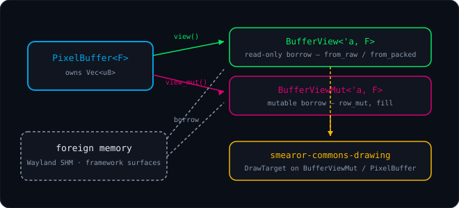

# Views

`BufferView<'a, F>` and `BufferViewMut<'a, F>` are the borrowed side of
the crate — they describe pixel data the caller **doesn't own**:
Wayland SHM pools, surfaces handed over by a framework, a slice inside
someone else's allocation.

<figure class="diagram">
  
  <figcaption>views validate foreign memory once, then lend it to drawing</figcaption>
</figure>

## Construction is validation

Both constructors take raw bytes plus `BufferMetadata` and check the
contract up front — after `from_raw` returns `Ok`, every accessor is
infallible:

```rust
use smearor_commons_buffer::{BufferMetadata, BufferView, Bgra, Stride};
use smearor_commons_geometry::Pixels;

let shm: &[u8] = /* Wayland pool contents */;
let meta = BufferMetadata::new(Pixels::new(800), Pixels::new(480), Stride::new(3328));

let view = BufferView::<Bgra>::from_raw(shm, meta)?;   // validates stride + length
view.row(Pixels::new(0));                              // Option<&[u8]> — pixels only, no padding
view.pixel_offset(Pixels::new(10), Pixels::new(3));    // Option<usize> into the slice
view.is_packed();                                      // false
```

For packed callers, `from_packed(data, size)` builds the metadata
itself.

## Mutable views write foreign memory in place

`BufferViewMut` adds `data_mut()`, `row_mut(y)` and `fill(pixel)` —
packed views get a single word-sized pass, strided views fill per row
and **leave padding bytes untouched**:

```rust
use smearor_commons_buffer::{BufferViewMut, Rgba};
use smearor_commons_geometry::Size;

let mut backing = vec![0u8; 640 * 480 * 4];
let mut view = BufferViewMut::<Rgba>::from_packed(&mut backing, Size::new(640, 480))?;
view.fill(&[0x0a, 0x0e, 0x16, 0xff]);      // smearor background, everywhere
```

## Why views, not just `&mut [u8]`

Consumers like `smearor-commons-drawing` render into
`BufferViewMut` — accepting a view instead of a bare slice means the
extent, stride and format are already agreed upon. The `F` parameter
does the same job as on `PixelBuffer`: the compiler rejects drawing
RGBA into memory laid out as BGR.
