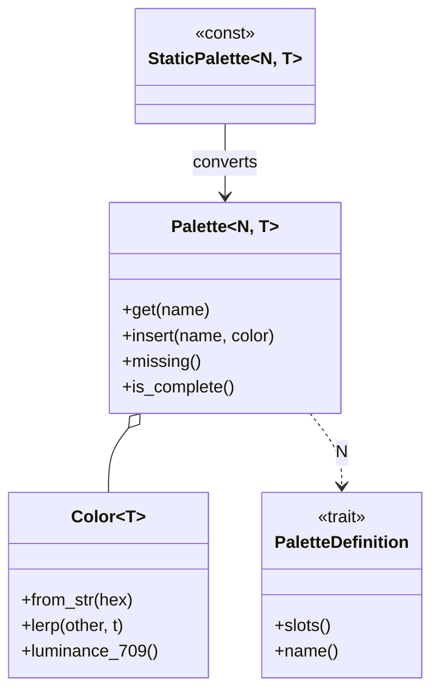

# smearor-commons-color

Channel-generic `Color<T>` with hex `FromStr`/`Display` (`#rgb`,
`#rgba`, `#rrggbb`, `#rrggbbaa`), alpha handling (`Alpha`,
`AlphaPercent`) and consolidated operations (`luminance`,
`luminance_601`, `luminance_709`, `lerp`, `lighten`, `brighten`,
`with_min_luminance`, `alpha_over`).

## Palettes

`Palette<N, T>` maps semantic names to colors. The `palette_definition!`
macro generates a fieldless enum plus its `PaletteDefinition`
implementation, so every lookup is type-checked and `missing()`/
`is_complete()` verify that all declared slots are filled. `NamedColor`
is the dynamic string key for palettes without a fixed vocabulary;
`static_palette!` builds a `const`-evaluable `StaticPalette` that
converts into `Palette`.

Feature gates: `cairo` and `gtk4` bridge `Color` into cairo source
calls and `gdk::RGBA`. See the crate's rustdoc for the full API.
