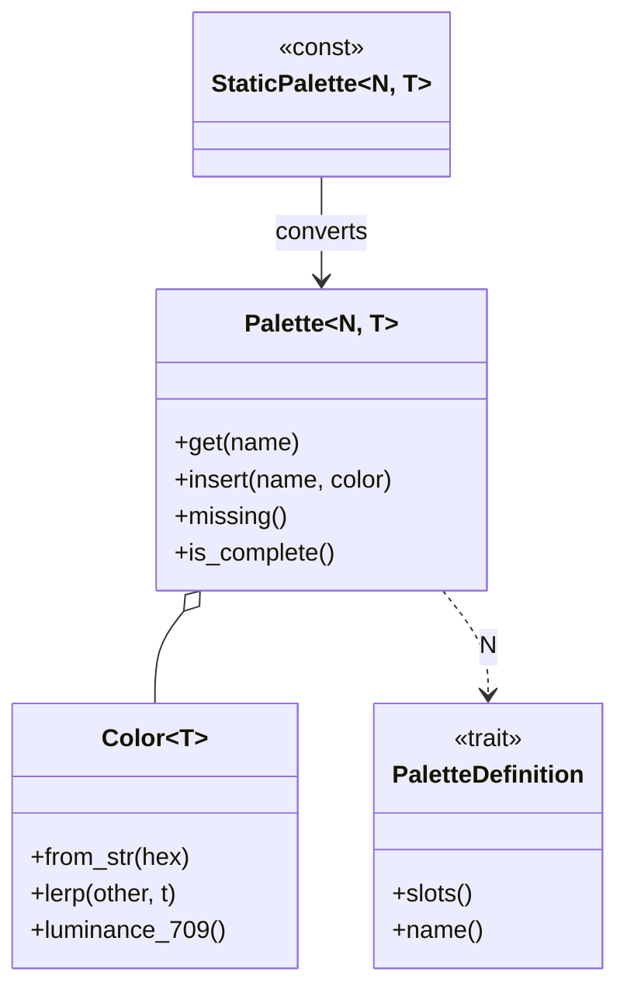

# smearor-commons-color

Channel-generic `Color<T>` (normalized `f64`/`f32` and byte `u8`) with
hex `FromStr`/`Display`, alpha handling and consolidated operations —
plus alternate color spaces, classic color-order systems, three named
vocabularies and a complete palette layer.

## One type, many doors in

`Color<T>` is the single currency: `u8` for wire and buffer work,
`f64`/`f32` for math. Around it the crate layers everything a color
pipeline needs:

- **[Representations](color/representations.md)** — the three channel
  types, the `#rgb`/`#rrggbb`/`#rrggbbaa` hex grammar, `HexColor` and
  `ParseColorError`.
- **[Color Spaces](color/spaces.md)** — `Hsl`, `Hsv`, `Cmyk`, `Xyz`,
  `Lab` and `Hue`, connected by `From` conversions (Lab via `Xyz`).
- **[Components](color/components.md)** — the channel newtypes `Alpha`,
  `AlphaPercent`, `Saturation`, `Lightness`, `Value`, `Luminance`,
  `LuminanceWeights`, `LabLightness`.
- **[Operations](color/operations.md)** — `lerp`, `lighten`,
  `brighten`, `luminance`/`_601`/`_709`, `with_min_luminance`,
  `alpha_over`, `with_alpha`, `fade`, `normalized`, `clamp`.
- **[Color Systems](color/systems.md)** — `Ncs`/`NcsHue`, `Ostwald`,
  the `MUNSELL_SAMPLES` atlas, `SPECTRAL_LOCUS`/`PLANCKIAN_LOCUS`
  chromaticity tables.
- **[Named Colors](color/named.md)** — `CssNamedColor` (148 keywords),
  `PantoneNamedColor` (PMS + `to_cmyk`/`nearest`/`counterpart`),
  `PantoneFhiNamedColor` (2310 FHI swatches) and the dynamic
  `NamedColor` key.
- **[Palettes](color/palettes.md)** — `Palette<N, T>` name→color maps,
  `palette_definition!`/`static_palette!` macros, `PaletteBuilder`,
  `StaticPalette` — with completeness checks on enum vocabularies.
- **[Decades](color/decades.md)** — all 89 curated palettes of
  *"Pantone: The Twentieth Century in Color"* as `const`s, visualized.

Feature gates: `cairo` and `gtk4` bridge `Color` into cairo source
calls and `gdk::RGBA`; `schemars`/`async-graphql`/`zbus` add schema
derives where they fit. On `cairo`, all three channel types
(`u8`/`f32`/`f64`) share the same source-setting vocabulary:
`apply(ctx)` sets the RGB source, `apply_rgba(ctx)` includes the
color's own alpha channel, `apply_alpha(ctx, alpha)` overrides it.
See the crate's rustdoc for the full API.
