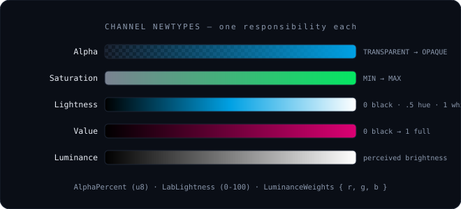

# Components

Scalar channel newtypes — each owns one concept, converts from `f64` /
`u8` where it fits, and stays `serde(transparent)` on the wire.

<figure class="diagram">
  
  <figcaption>five channel newtypes, each with its own 0-1 meaning</figcaption>
</figure>

## Alpha & AlphaPercent

`Alpha(f64)` is the opacity channel `0.0-1.0` with
`TRANSPARENT`/`OPAQUE` consts and bridges to both float and byte
representations:

```rust
use smearor_commons_color::{Alpha, AlphaPercent};

let half = Alpha::new(0.5);
half.as_u8();                // 128
Alpha::from_percent(50);     // same thing
half.percent();              // 50
half.is_transparent();       // false

let p = AlphaPercent::new(50); // the integer-percent twin (u8)
p.as_f64();                    // 0.5
```

`AlphaPercent(pub u8)` exists for config formats and protocols that
speak integer percents — `0-100`, `OPAQUE = 100`.

## Saturation, Lightness, Value

The three `Hsl`/`Hsv` channels, all `0.0-1.0` with `MIN`/`MAX` consts:

- `Saturation` — `0` gray to `1` full chroma (shared by both spaces)
- `Lightness` — `0` black, `0.5` pure hue, `1` white (HSL axis)
- `Value` — `0` black to `1` full brightness (HSV axis)

```rust
use smearor_commons_color::{Hsl, Saturation};

let muted = Hsl::new(200.0, Saturation::new(0.4), 0.6);
```

## Hue

`Hue(f64)` — degrees on the color circle, wrapping on construction.
`From<f64>`/`Into<f64>` both ways, used by `Hsl`, `Hsv`, `Ostwald`,
`Ncs` and the `Lab::hue` view.

## Luminance & LuminanceWeights

`Luminance(f64)` is perceived brightness `0-1`. `Color::luminance`
takes a `LuminanceWeights` — the channel triple `w_r, w_g, w_b` — so
the standard is a value, not hard-coded:

```rust
use smearor_commons_color::{Color, LuminanceWeights};

let brand = Color::<u8>::new(0xdc, 0x00, 0x73);
brand.luminance(LuminanceWeights::REC_709);  // HDTV weights
brand.luminance_709();                       // same, shorthand
brand.luminance_601();                       // legacy SDTV weights
```

`REC_709` (`0.2126 / 0.7152 / 0.0722`) is the modern default;
`REC_601` (`0.299 / 0.587 / 0.114`) stays for parity with legacy
tooling.

## LabLightness

`LabLightness(f64)` — the `L*` axis `0-100` (`ZERO`, `WHITE`,
`clamped()`). Kept separate from `Lightness` on purpose: same word,
different scale.
