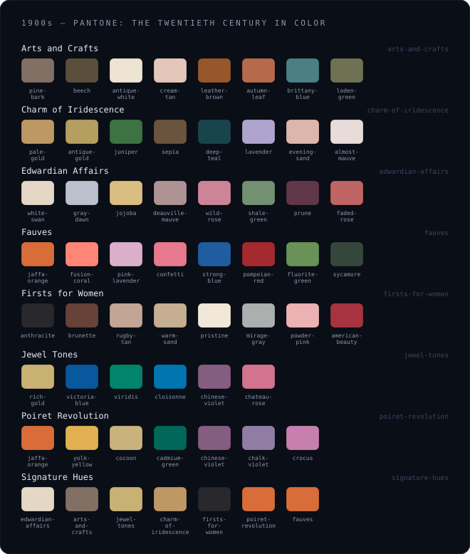
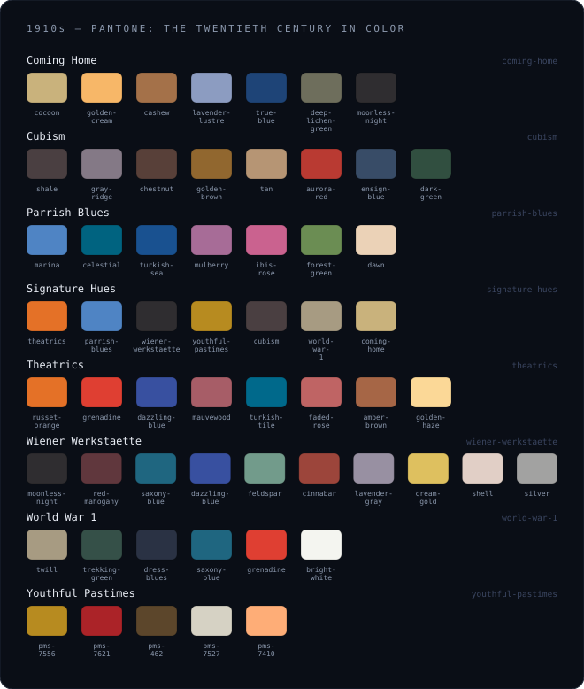
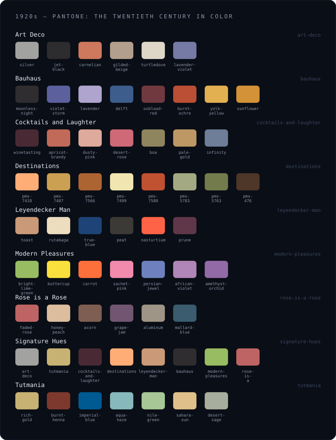
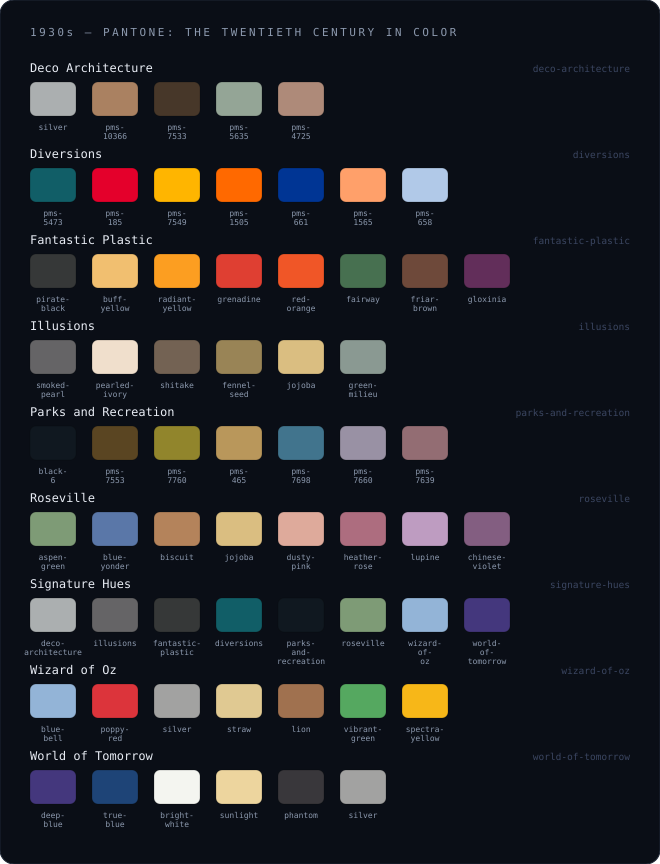
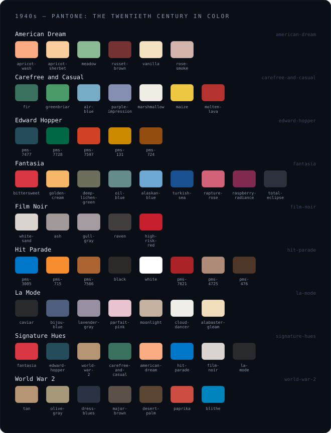
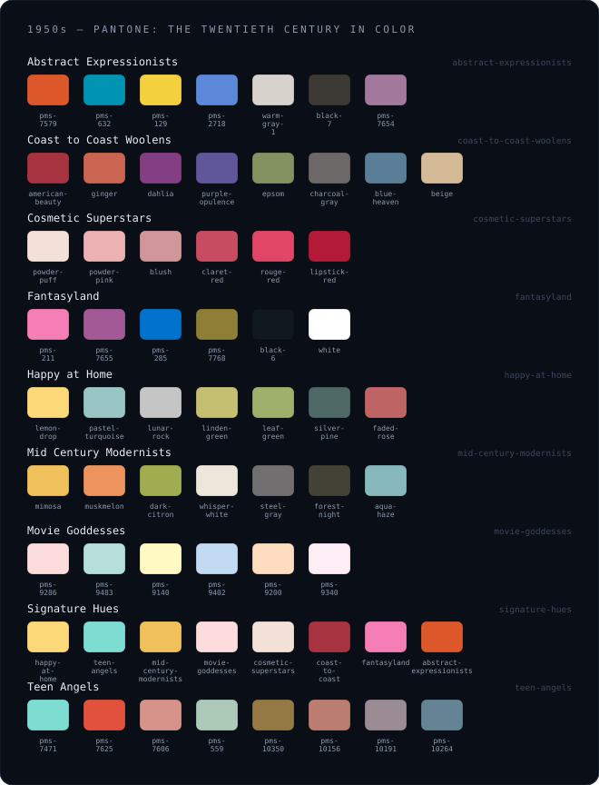
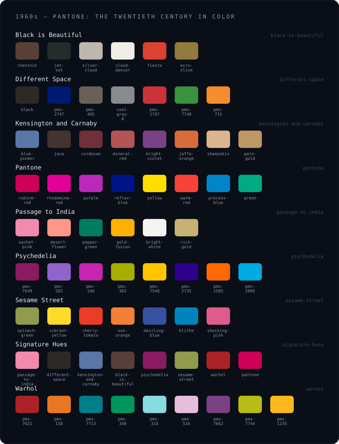
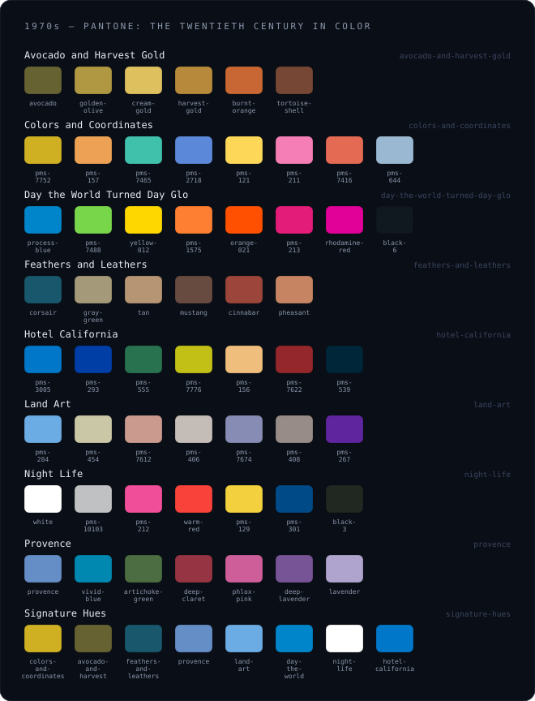
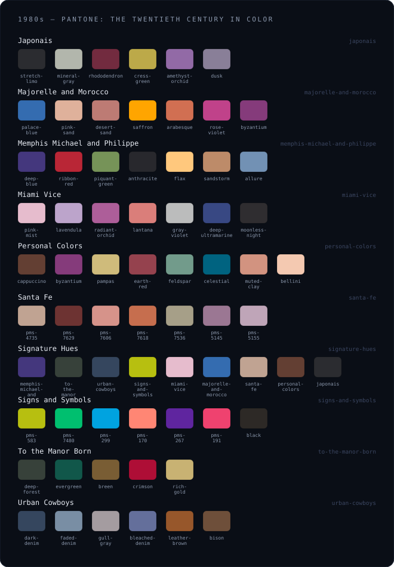
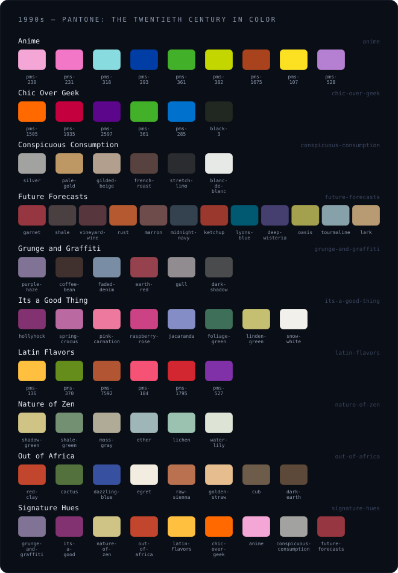

# Decades

The 89 palettes of *"Pantone: The Twentieth Century in Color"*
(Eiseman & Recker, 2011) — one set per chapter of the book, each a
`StaticPalette` const with its own `palette_definition!` enum. Slot
names and order match the book's swatch rows; TCX/TPG swatches resolve
through [`PantoneFhiNamedColor`](named.md), solid-coated numbers
through [`PantoneNamedColor`](named.md).

```rust
use smearor_commons_color::{BauhausColor, PaletteDefinition, BAUHAUS};

for (slot, color) in BAUHAUS.entries() {
    // slot: BauhausColor, color: Color<u8>
    println!("{} = {}", slot.name(), color);
}
BAUHAUS.get(&BauhausColor::Sunflower);
```

## 1900s

<figure class="diagram">
  
</figure>

| Const | Palette | Slots |
|---|---|---|
| `ARTS_AND_CRAFTS` | Arts and Crafts | 8 |
| `CHARM_OF_IRIDESCENCE` | Charm of Iridescence | 8 |
| `EDWARDIAN_AFFAIRS` | Edwardian Affairs | 8 |
| `FAUVES` | Fauves | 8 |
| `FIRSTS_FOR_WOMEN` | Firsts for Women | 8 |
| `JEWEL_TONES` | Jewel Tones | 6 |
| `POIRET_REVOLUTION` | Poiret Revolution | 7 |
| `SIGNATURE_HUES_1900` | Signature Hues | 7 |

## 1910s

<figure class="diagram">
  
</figure>

| Const | Palette | Slots |
|---|---|---|
| `COMING_HOME` | Coming Home | 7 |
| `CUBISM` | Cubism | 8 |
| `PARRISH_BLUES` | Parrish Blues | 7 |
| `SIGNATURE_HUES_1910` | Signature Hues | 7 |
| `THEATRICS` | Theatrics | 8 |
| `WIENER_WERKSTAETTE` | Wiener Werkstaette | 10 |
| `WORLD_WAR_1` | World War 1 | 6 |
| `YOUTHFUL_PASTIMES` | Youthful Pastimes | 5 |

## 1920s

<figure class="diagram">
  
</figure>

| Const | Palette | Slots |
|---|---|---|
| `ART_DECO` | Art Deco | 6 |
| `BAUHAUS` | Bauhaus | 8 |
| `COCKTAILS_AND_LAUGHTER` | Cocktails and Laughter | 7 |
| `DESTINATIONS` | Destinations | 8 |
| `LEYENDECKER_MAN` | Leyendecker Man | 6 |
| `MODERN_PLEASURES` | Modern Pleasures | 7 |
| `ROSE_IS_A_ROSE` | Rose is a Rose | 6 |
| `SIGNATURE_HUES_1920` | Signature Hues | 8 |
| `TUTMANIA` | Tutmania | 7 |

## 1930s

<figure class="diagram">
  
</figure>

| Const | Palette | Slots |
|---|---|---|
| `DECO_ARCHITECTURE` | Deco Architecture | 5 |
| `DIVERSIONS` | Diversions | 7 |
| `FANTASTIC_PLASTIC` | Fantastic Plastic | 8 |
| `ILLUSIONS` | Illusions | 6 |
| `PARKS_AND_RECREATION` | Parks and Recreation | 7 |
| `ROSEVILLE` | Roseville | 8 |
| `SIGNATURE_HUES_1930` | Signature Hues | 8 |
| `WIZARD_OF_OZ` | Wizard of Oz | 7 |
| `WORLD_OF_TOMORROW` | World of Tomorrow | 6 |

## 1940s

<figure class="diagram">
  
</figure>

| Const | Palette | Slots |
|---|---|---|
| `AMERICAN_DREAM` | American Dream | 6 |
| `CAREFREE_AND_CASUAL` | Carefree and Casual | 7 |
| `EDWARD_HOPPER` | Edward Hopper | 5 |
| `FANTASIA` | Fantasia | 9 |
| `FILM_NOIR` | Film Noir | 5 |
| `HIT_PARADE` | Hit Parade | 8 |
| `LA_MODE` | La Mode | 7 |
| `SIGNATURE_HUES_1940` | Signature Hues | 8 |
| `WORLD_WAR_2` | World War 2 | 7 |

## 1950s

<figure class="diagram">
  
</figure>

| Const | Palette | Slots |
|---|---|---|
| `ABSTRACT_EXPRESSIONISTS` | Abstract Expressionists | 7 |
| `COAST_TO_COAST_WOOLENS` | Coast to Coast Woolens | 8 |
| `COSMETIC_SUPERSTARS` | Cosmetic Superstars | 6 |
| `FANTASYLAND` | Fantasyland | 6 |
| `HAPPY_AT_HOME` | Happy at Home | 7 |
| `MID_CENTURY_MODERNISTS` | Mid Century Modernists | 7 |
| `MOVIE_GODDESSES` | Movie Goddesses | 6 |
| `SIGNATURE_HUES_1950` | Signature Hues | 8 |
| `TEEN_ANGELS` | Teen Angels | 8 |

## 1960s

<figure class="diagram">
  
</figure>

| Const | Palette | Slots |
|---|---|---|
| `BLACK_IS_BEAUTIFUL` | Black is Beautiful | 6 |
| `DIFFERENT_SPACE` | Different Space | 7 |
| `KENSINGTON_AND_CARNABY` | Kensington and Carnaby | 8 |
| `PANTONE` | Pantone | 8 |
| `PASSAGE_TO_INDIA` | Passage to India | 6 |
| `PSYCHEDELIA` | Psychedelia | 8 |
| `SESAME_STREET` | Sesame Street | 7 |
| `SIGNATURE_HUES_1960` | Signature Hues | 8 |
| `WARHOL` | Warhol | 9 |

## 1970s

<figure class="diagram">
  
</figure>

| Const | Palette | Slots |
|---|---|---|
| `AVOCADO_AND_HARVEST_GOLD` | Avocado and Harvest Gold | 6 |
| `COLORS_AND_COORDINATES` | Colors and Coordinates | 8 |
| `DAY_THE_WORLD_TURNED_DAY_GLO` | Day the World Turned Day Glo | 8 |
| `FEATHERS_AND_LEATHERS` | Feathers and Leathers | 6 |
| `HOTEL_CALIFORNIA` | Hotel California | 7 |
| `LAND_ART` | Land Art | 7 |
| `NIGHT_LIFE` | Night Life | 7 |
| `PROVENCE` | Provence | 7 |
| `SIGNATURE_HUES_1970` | Signature Hues | 8 |

## 1980s

<figure class="diagram">
  
</figure>

| Const | Palette | Slots |
|---|---|---|
| `JAPONAIS` | Japonais | 6 |
| `MAJORELLE_AND_MOROCCO` | Majorelle and Morocco | 7 |
| `MEMPHIS_MICHAEL_AND_PHILIPPE` | Memphis Michael and Philippe | 7 |
| `MIAMI_VICE` | Miami Vice | 7 |
| `PERSONAL_COLORS` | Personal Colors | 8 |
| `SANTA_FE` | Santa Fe | 7 |
| `SIGNATURE_HUES_1980` | Signature Hues | 9 |
| `SIGNS_AND_SYMBOLS` | Signs and Symbols | 7 |
| `TO_THE_MANOR_BORN` | To the Manor Born | 5 |
| `URBAN_COWBOYS` | Urban Cowboys | 6 |

## 1990s

<figure class="diagram">
  
</figure>

| Const | Palette | Slots |
|---|---|---|
| `ANIME` | Anime | 9 |
| `CHIC_OVER_GEEK` | Chic Over Geek | 6 |
| `CONSPICUOUS_CONSUMPTION` | Conspicuous Consumption | 6 |
| `FUTURE_FORECASTS` | Future Forecasts | 12 |
| `GRUNGE_AND_GRAFFITI` | Grunge and Graffiti | 6 |
| `ITS_A_GOOD_THING` | Its a Good Thing | 8 |
| `LATIN_FLAVORS` | Latin Flavors | 6 |
| `NATURE_OF_ZEN` | Nature of Zen | 6 |
| `OUT_OF_AFRICA` | Out of Africa | 8 |
| `SIGNATURE_HUES_1990` | Signature Hues | 9 |
