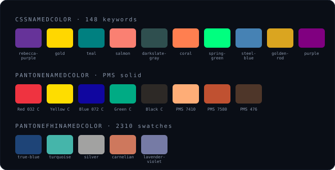

# Named Colors

Three closed vocabularies ship as fieldless enums — every name is a
variant, every variant knows its sRGB value, and `FromStr`/`Display`
speak the canonical notation.

<figure class="diagram">
  
  <figcaption>one enum per vocabulary — names become chips</figcaption>
</figure>

## CssNamedColor — the web keywords

All 148 CSS Color Level 4 keywords (`rebeccapurple`, `darkslategray`,
`transparent`, ...):

```rust
use std::str::FromStr;
use smearor_commons_color::CssNamedColor;

let c = CssNamedColor::from_str("teal")?;   // case-insensitive
c.as_str();                                  // "teal"
c.to_color();                                // Color<u8> #008080
CssNamedColor::ALL;                          // the full keyword list
```

## PantoneNamedColor — the PMS ink catalog

The Pantone Matching System solid colors — numbered inks with
substrate suffixes `C` coated, `U` uncoated, `M` matte:

```rust
use std::str::FromStr;
use smearor_commons_color::PantoneNamedColor;

let red = PantoneNamedColor::from_str("Pantone 485 C")?;
red.to_color();       // approximate sRGB
red.to_cmyk();        // Option<Cmyk> — published print values where known
red.suffix();         // PantoneSuffix::Coated
red.counterpart();    // the same ink on another substrate, if it exists
PantoneNamedColor::nearest(&color); // closest catalog match to any color
```

`FromStr` accepts the canonical `Pantone <num> <suffix>` form plus
lenient variants; `nearest(&Color<u8>)` does a squared-RGB-distance
lookup over `ALL` — the bridge from arbitrary input to "which Pantone
is that".

## PantoneFhiNamedColor — Fashion, Home + Interiors

The FHI vocabulary: 2310 colors addressed by `NN-NNNN` code *and* name
(`Pantone 19-4057 TCX True Blue`). Suffixes describe the substrate:
`TCX` cotton (canonical), `TPX` paper (discontinued), `TPG` current
paper guide — `PantoneFhiSuffix::{Cotton, Paper, PaperGreen}`.

```rust
use std::str::FromStr;
use smearor_commons_color::PantoneFhiNamedColor;

let blue = PantoneFhiNamedColor::from_str("19-4057")?;       // bare code
let same = PantoneFhiNamedColor::from_str("True Blue")?;     // bare name
blue.to_color();                                             // sRGB approximation
blue.counterpart();                                          // across substrates
```

The stored sRGB values are community approximations of the physical
swatches — indicative, not authoritative. (PANTONE is a trademark of
Pantone LLC.)

## NamedColor — the open key

`NamedColor(Cow<'static, str>)` is the dynamic palette key for
vocabularies that aren't fixed at compile time — user-defined slot
names, theme files, wire names:

```rust
use smearor_commons_color::NamedColor;

let key = NamedColor::new("brand-primary");
key.as_str();
```

It deliberately does *not* implement `PaletteDefinition` — dynamic
keys get palette lookups, not compile-time completeness checks.
