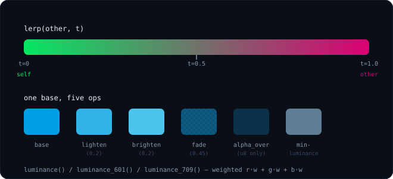

# Operations

The consolidated color math lives on `Color<T>` itself — same method
names on all three channel types, computing in the natural precision
of each.

<figure class="diagram">
  
  <figcaption>interpolation and the everyday channel ops</figcaption>
</figure>

## Interpolation & brightness

```rust
use smearor_commons_color::Color;

let a = Color::<u8>::new(0x04, 0xe7, 0x62);
let b = Color::<u8>::new(0xdc, 0x00, 0x73);

let mid = a.lerp(&b, 0.5);           // channel-wise blend
let lighter = a.lighten(0.3);        // shift toward white
let brighter = a.brighten(0.2);      // add to every channel
```

`lerp(other, t)` blends per channel (`t` unclamped — overshoot
interpolates past the target). `lighten(factor)` moves toward white by
a fraction of the remaining headroom; `brighten(amount)` adds an
absolute offset — the difference shows on already-bright colors.

## Luminance-aware ops

```rust
use smearor_commons_color::{Color, Luminance};

let ink = Color::<u8>::new(0x8b, 0x98, 0xad);
let legible = ink.with_min_luminance(Luminance::new(0.4)); // lift until readable
ink.luminance_709();                                       // perceived brightness
```

`with_min_luminance` brightens the color *just enough* — for text and
icons that must stay legible on dark surfaces without a hand-picked
fallback.

## Alpha ops

```rust
use smearor_commons_color::{Alpha, Color};

let ghost = Color::<u8>::new(0x00, 0xa1, 0xe4).fade(0.4);     // scale alpha
let solid = ghost.with_alpha(Alpha::OPAQUE);                  // set alpha
let blend = Color::<u8>::new(0xdc, 0x00, 0x73).alpha_over(&solid, 0.5); // composite
```

`with_alpha` sets the channel, `fade` multiplies it. `alpha_over` is
the byte-space composite — source over destination with an explicit
strength — used by the buffer crate's software rasterizer.

## Normalization & distance

- `normalized()` — scales `f64`/`f32` channel values outside `0.0-1.0`
  back into range
- `clamp()` — hard-clamps every channel (no rescale)
- `squared_rgb_distance(&other)` — `u32` squared RGB distance, the
  cheap metric behind `PantoneNamedColor::nearest` /
  `PantoneFhiNamedColor::nearest`

## Cross-type conversion as an operation

`From` between `Color<u8>` ↔ `Color<f64>`/`f32` is how most
"operations" are structured: promote to `f64` for math, demote back
to `u8` for storage — normalization and rounding handled for you.
