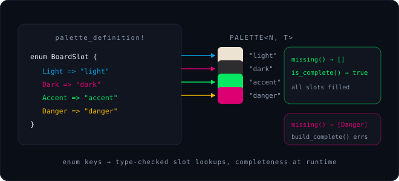

# Palettes

A `Palette<N, T>` maps *names* to colors: semantic slots on the left,
`Color<T>` values on the right. The key type `N` decides how much
safety you get.

<figure class="diagram">
  
  <figcaption>enum keys make every lookup type-checked</figcaption>
</figure>

## Defining a vocabulary: palette_definition!

```rust
use smearor_commons_color::{palette_definition, PaletteDefinition};

palette_definition! {
    /// Colors of a chess board theme.
    pub enum BoardSlot {
        /// Light squares.
        Light => "light",
        /// Dark squares.
        Dark => "dark",
        /// Highlights and accents.
        Accent => "accent"
    }
}
```

The macro generates the fieldless enum plus its `PaletteDefinition`
impl: `slots()` (all variants in order) and `name()` (the wire string).
Derived: `Copy`, `Hash`, `serde` — variants serialize as their names.

## Filling it: Palette / PaletteBuilder

```rust
use smearor_commons_color::{Color, Palette};

let mut palette = Palette::builder()
    .color(BoardSlot::Light, Color::<u8>::new(0xed, 0xe3, 0xd2))
    .color(BoardSlot::Dark, Color::<u8>::new(0x2d, 0x2c, 0x2f))
    .build();

palette.missing();                    // [Accent]
palette.is_complete();                // false
palette.insert(BoardSlot::Accent, Color::<u8>::new(0x04, 0xe7, 0x62));
palette.get(&BoardSlot::Accent);      // Some(&Color)
palette.get_or(&BoardSlot::Accent, Color::<u8>::default()); // fallback lookup
palette.ordered();                    // iterates in declaration order
```

`build()` never fails — incomplete is a legal runtime state.
`build_complete()` returns `Result<_, PaletteBuildError<N>>` and
fails with `Missing(Vec<N>)` listing exactly the unfilled slots.

`map_colors` transforms every value at once (e.g. fade a whole theme);
`iter`/`colors` expose the underlying `HashMap`.

## Compile-time palettes: StaticPalette

`static_palette!` assembles a `const`-evaluable
`StaticPalette<N, T>` — entries are `&'static [(N, Color<T>)]`, so the
whole palette lives in `.rodata` and converts into a `Palette` when
you need mutation:

```rust
use smearor_commons_color::{Palette, StaticPalette};

let theme: Palette<_, u8> = smearor_commons_color::ART_DECO.into();
theme.get(&smearor_commons_color::ArtDecoColor::Carnelian);
```

This is how the decade palettes ship: a `palette_definition!` enum for
the slot vocabulary, a `static_palette!` const for the values —
type-checked slots, zero runtime construction. See
[Decades](decades.md) for all 89 of them.

## Choosing the key type

| Key | Use when | Completeness |
|---|---|---|
| generated enum (`palette_definition!`) | the vocabulary is fixed — themes, UI slots | `missing()`/`is_complete()`/`build_complete()` |
| `NamedColor` (dynamic string) | names come from config/files/wire | lookup only — no static slot list |

`Palette<N, T>` itself is `serde`-transparent for both.
