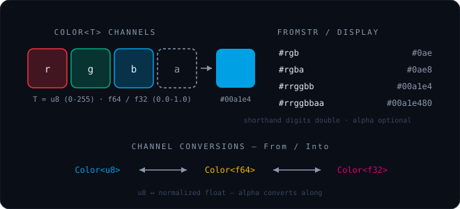

# Representations

`Color<T>` is one struct — `r`, `g`, `b`, `a` channels — parameterized
by the channel scalar `T`. Three instantiations cover every use case:

<figure class="diagram">
  
  <figcaption>one type, three channel scalars, one hex grammar</figcaption>
</figure>

| Type | Range | Role |
|---|---|---|
| `Color<u8>` | `0-255` per channel | the canonical wire/render form — buffers, hex, Pantone lookups |
| `Color<f64>` | `0.0-1.0` normalized | math space — `lerp`, `luminance`, space conversions compute here |
| `Color<f32>` | `0.0-1.0` normalized | the GPU/framework flavor of the same |

```rust
use std::str::FromStr;
use smearor_commons_color::Color;

let byte = Color::<u8>::new(0x00, 0xa1, 0xe4);
let rgba = Color::<u8>::new_rgba(0x00, 0xa1, 0xe4, 0x80);
let packed = Color::<u8>::from_rgb_u32(0x00a1e4);
let float: Color<f64> = byte.into();          // lossless normalization
let back: Color<u8> = float.into();           // scales + rounds back
```

All `From` conversions convert alpha along, and `[u8; 4]` arrays
convert in both directions for framebuffer interop. `Default` is
opaque black for all three channel types.

## Text form: HexColor

`FromStr` and `Display` speak a single grammar on every channel type:

```rust
use std::str::FromStr;
use smearor_commons_color::Color;

let c = Color::<u8>::from_str("#00a1e4")?;   // 6-digit
let s = Color::<u8>::from_str("#0ae")?;      // shorthand — digits double
let a = Color::<u8>::from_str("#00a1e480")?; // explicit alpha
c.to_string();                               // "#00a1e4" — alpha emitted only when non-opaque
```

`HexColor` is the strict newtype wrapper around `Color<u8>` for APIs
that take a *stringly* color — it validates on construction and its
serde is lenient on read: a `CssNamedColor` keyword (`"red"`,
`"transparent"`) also deserializes into the matching hex value.

## Errors: ParseColorError

One `thiserror` enum covers every parser in the crate and says *why*:

- hex syntax: `MissingHashPrefix`, `InvalidDigitCount`,
  `InvalidHexDigit`
- vocabulary: `UnknownNamedColor`, `UnknownPantoneColor`,
  `UnknownPantoneSuffix`, `UnknownPantoneFhiColor`,
  `UnknownPantoneFhiSuffix`
- catch-all `InvalidColor` when `Color`'s `FromStr` matches neither
  grammar

Every variant keeps the offending `input`, and `input()` exposes it for
diagnostics.
