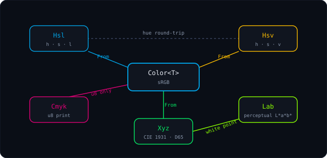

# Color Spaces

`Color<T>` stores plain sRGB. Alternate spaces are small structs with
`From`/`Into` conversions — convert, manipulate, convert back.

<figure class="diagram">
  
  <figcaption>all conversions go through From — Lab detours via Xyz</figcaption>
</figure>

## Hsl & Hsv — the cylindrical pair

```rust
use smearor_commons_color::{Color, Hsl, Hsv};

let blue: Hsl = Color::<u8>::new(0x00, 0xa1, 0xe4).into();
let desaturated = Hsl::new(blue.h, blue.s.as_f64() * 0.5, blue.l);
let rgb: Color<u8> = desaturated.into();

let hsv: Hsv = blue.into();                 // Hsl ↔ Hsv both ways
```

`Hsl { h, s, l }` puts pure hues at `l = 0.5` (`0` black, `1` white);
`Hsv { h, s, v }` puts them at `v = 1`. Both round-trip through the
standard sRGB transforms; `Display` renders the `hsl(h, s%, l%)` /
`hsv(...)` notation.

## Cmyk — print output

`Cmyk { c, m, y, k }` in `u8` — the naive device conversion for print
pipelines, `u8`-only (`From<Color<u8>>` both ways). Pantone swatches
with published print values bypass the naive path: see
`PantoneNamedColor::to_cmyk`.

## Xyz — the hub

`Xyz { x, y, z }` is CIE 1931 XYZ — the interchange every other space
hangs off. `From<Color<u8>>`/`Color<f64>` performs the linearized sRGB
matrix; named white points ship as consts:

```rust
use smearor_commons_color::{Color, Xyz};

let xyz: Xyz = Color::<u8>::new(0xdc, 0x00, 0x73).into();
let (x, y, _) = xyz.to_xyy();               // chromaticity + luminance
let d50 = xyz.adapted(Xyz::WHITE_D65, Xyz::WHITE_D50); // white adaptation
```

`WHITE_D65`, `WHITE_D50`, `WHITE_C` cover the standard illuminants;
`Xyz::from_xyy` rebuilds a tristimulus from chromaticity coordinates —
exactly what [`SPECTRAL_LOCUS`](../color.md) and `MunsellSample`
provide.

## Lab — perceptual space

`Lab { l, a, b }` is CIELAB: `l` is `LabLightness` (`0-100`), `a`/`b`
the opponent axes. Conversion needs a reference white:

```rust
use smearor_commons_color::{Color, Lab, Xyz};

let lab: Lab = Color::<u8>::new(0xdc, 0x00, 0x73).into(); // D65 by default
let lch = (lab.chroma(), lab.hue());                     // cylindrical view
let back: Color<u8> = lab.into();
```

`from_xyz(xyz, white)`/`to_xyz(white)` accept the illuminant
explicitly; the `Color` impls pick `WHITE_D65`. `chroma()` and `hue()`
give the LCh view — perceptual distance and hue angle without a
dedicated type.

## Hue

`Hue(f64)` is the shared degree newtype all cylindrical spaces use —
`Hue::new` wraps freely into `0-360`. It is also what `Ostwald`,
`NcsHue::lab_hue` and `MunsellSample::hue_angle` produce.
