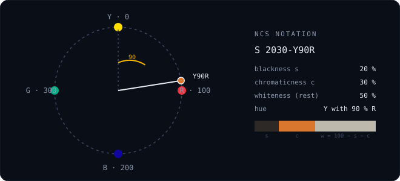
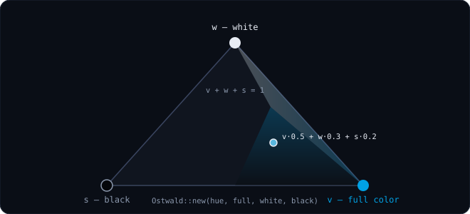
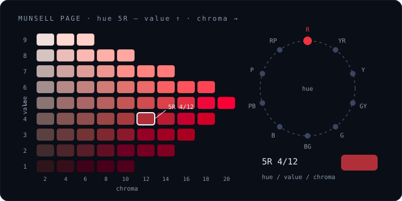

# Color Systems

Beyond raw RGB, the crate models three classic *color-order systems* —
each with its own notation, its own geometry, and a documented
approximation of the official atlas where the originals are
proprietary.

## NCS — Natural Color System

NCS describes a color as `blackness` + `chromaticness` + a hue on the
elementary circle `Y → R → B → G` (`0` = yellow, `100` = red,
`200` = blue, `300` = green — the position is the percentage walk
toward the next elementary hue).

<figure class="diagram">
  
  <figcaption>S 2030-Y90R: 20% black, 30% chroma, hue at 90% from Y to R</figcaption>
</figure>

```rust
use smearor_commons_color::{Ncs, NcsHue};

let hue = NcsHue::new(90.0);            // Y90R — 90% from yellow toward red
let color = Ncs::new(hue, 20.0, 30.0);  // "S 2030-Y90R"
color.whiteness();                       // 50.0 — the remainder
let rgb = color.color();                 // Color<u8> via CIELAB anchors
```

The mapping is a *documented approximation*: official NCS atlas values
are proprietary, so `color()` maps hue onto CIELAB angles between the
four elementary anchors and blackness/chromaticness onto `L*`/`C*`.
Geometry and notation are the real NCS ones.

## Ostwald — the pigment triangle

Ostwald models a color as a mixture: `v` full color + `w` white +
`s` black, constrained to `v + w + s = 1`. Every hue is a triangle;
every color a point inside it.

<figure class="diagram">
  
  <figcaption>each hue its own triangle of mixtures</figcaption>
</figure>

```rust
use smearor_commons_color::{Hue, Ostwald};

let mixed = Ostwald::new(Hue::new(200.0), 0.5, 0.3, 0.2);
let rgb = mixed.color();                 // idealized linear sRGB mixture
let pure = Ostwald::full_color(Hue::new(200.0)); // the vertex itself
```

## Munsell — the atlas

`MUNSELL_SAMPLES` is the published Munsell renotation dataset — 2734
samples with the real `hue/value/chroma` notation and their CIE `x`,
`y` chromaticities (illuminant C). The three axes organize the atlas:
hue steps around 10 sectors (`R YR Y GY G BG B PB P RP`), value climbs
`1-9` dark to light, chroma grows outward from the neutral axis — the
classic "Munsell page" per hue:

<figure class="diagram">
  
  <figcaption>all 63 samples of hue 5R — the tree widens where the hue gets saturated</figcaption>
</figure>

```rust
use smearor_commons_color::{MunsellSample, MUNSELL_SAMPLES};

let sample = MunsellSample::find("5R", 4.0, 12.0).copied();
sample.map(|s| (s.notation(), s.hue_angle(), s.to_color())); // "5R 4/12", Hue, sRGB
MunsellSample::neutral(5.0);                                 // a gray at value 5
```

`MunsellSample` also exposes `to_xyz()` — the real measurement path
through `Xyz::from_xyy`.

## Chromaticity tables

Two standard-observer datasets ship as static tables for anyone
reimplementing colorimetry:

- `SPECTRAL_LOCUS` — `(wavelength_nm, x, y)` monochromatic boundary of
  the CIE 1931 chromaticity diagram
- `PLANCKIAN_LOCUS` — `(kelvin, x, y)` blackbody chromaticities,
  1000 K to 20000 K in 100 K steps — white-point math for
  warm/cool lighting
