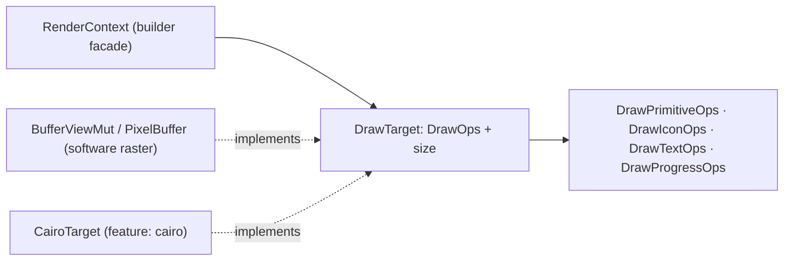

# smearor-commons-drawing

Shared rendering vocabulary on pixel buffers: primitives, icons, text
and progress indicators, split into per-capability traits —
`DrawPrimitiveOps`, `DrawIconOps`, `DrawTextOps` and `DrawProgressOps`
— so backends can implement them incrementally and consumers can bound
on exactly the capabilities they need. `DrawOps` bundles all four as a
supertrait, `DrawBackend` ties them to a single associated `Error`
type and `DrawTarget` adds the pixel extent plus the default color
policy (`default_text_color` for the active/inactive states).

The software-raster backend implements the vocabulary for
`BufferViewMut<Rgba>` and `PixelBuffer<Rgba>` out of the box. Behind
the `cairo` feature, `CairoTarget` renders the same vocabulary onto
cairo surfaces (`ViewSurface`, `image_surface_from_buffer`,
`DrawingError`); `gtk4` builds on top of that.

## What's inside

- [Traits](./drawing/traits.md) — `DrawBackend`'s error-as-property
  design, the four capability traits, `DrawOps`/`DrawTarget`, prelude
- [Primitives](./drawing/primitives.md) — the six shape specs plus
  `fill_background`, source-over blending
- [Icons](./drawing/icons.md) — `Icon`/`Codepoint`/`IconGrid`, the
  caller-resolved codepoint design, glyph scale cache
- [Text & Progress](./drawing/text-progress.md) — label/centered/
  positioned text, bitmap fallback, `ProgressBar` + `Gauge`
- [RenderContext](./drawing/render-context.md) — the builder facade:
  fonts, colors, `is_active`, tile layout conventions
- [Cairo](./drawing/cairo.md) — `CairoTarget`, zero-copy `ViewSurface`,
  surface bridges, path helpers, `DrawingError`

## Draw specs

Every operation takes a plain-data spec:

- **Primitives** — `FillRect`, `StrokeRect`, `FillCircle`,
  `FillPolygon`, `StrokePolyline`, `FillSector`.
- **Icons** — `Icon`, `Codepoint`, `IconGrid`; icon names are resolved
  through a caller-provided `resolve_codepoint` closure, so the crate
  stays font-agnostic.
- **Progress** — `ProgressBar` (anchored at the target's bottom edge,
  raised by `PROGRESS_BAR_BOTTOM_MARGIN`) and `Gauge` (circular ring).

## RenderContext

`RenderContext` is the builder facade over any `DrawTarget`: chain
`icon_font` / `label_font` / `background` / `icon_color` /
`text_color` / `active`, then call `draw_icon`, `draw_icon_by_name`,
`draw_label`, `draw_text`, `draw_progress_bar` or `draw_icon_grid`.

## Layering and fallbacks

- `ops` — the public, backend-neutral vocabulary (capability traits).
- `tech` — crate-internal adapters over rendering tech (`ab_glyph`
  glyph metrics); usable by any backend, not a backend itself.
- `buffer` — the software-raster backend: one module per capability,
  `buffer_view_mut` does the work and `pixel_buffer` delegates.
- `cairo` — the cairo backend behind its feature gate.

Fonts are injected as `&FontVec` parameters — loading and caching stay
with the consumer. Where a fallback exists the parameter is
`Option<&FontVec>`: icons fall back to `draw_icon_placeholder`, text to
the built-in bitmap renderer. `use smearor_commons_drawing::prelude::*`
brings all capability traits into scope at once. See the crate's
rustdoc for the full API.
