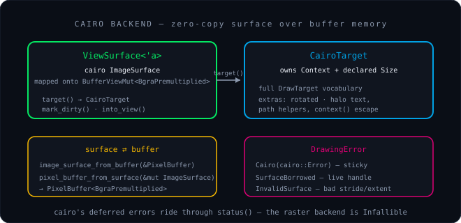

# Cairo

The `cairo` feature adds a second backend: `CairoTarget` implements
the same `DrawTarget` vocabulary on a `cairo::Context`, and bridging
helpers move pixels between cairo surfaces and buffer types without
copies where cairo allows it.

<figure class="diagram">
  
  <figcaption>cairo memory format = premultiplied BGRA — ViewSurface rides on it directly</figcaption>
</figure>

## `ViewSurface` — cairo on buffer memory

`ViewSurface::new(view)` wraps a `BufferViewMut<BgraPremultiplied>`
in a cairo `ImageSurface` whose pixel storage **is** the view's
memory — cairo draws straight into the buffer, zero copy. That works
because cairo's native 32-bit layout is exactly `BgraPremultiplied`.

```rust
use smearor_commons_drawing::{CairoTarget, ViewSurface};

let mut surface = ViewSurface::new(view)?;       // view: BufferViewMut<BgraPremultiplied>
let target = surface.target()?;                // CairoTarget into that memory
target.fill_background(color)?;                // same vocabulary as the raster backend
surface.mark_dirty();                          // tell cairo the pixels changed
let view = surface.into_view();                // hand the view back
```

## `CairoTarget` — a value-type render target

`CairoTarget::new(ctx, size)` clones a `Context` handle (a refcount
bump) plus a **declared** extent — deliberately a value type, so it can
be constructed inside GTK `snapshot`/`set_draw_func` callbacks and
owned by `RenderContext` like any other target. `size` takes
`impl Into<Size<u32>>` — a `Size<f64>` (GTK's allocated extent)
converts component-wise, truncating and saturating.

- `context()` — the escape hatch for anything outside the shared
  vocabulary: `save`/`restore`, transforms, patterns, sources
- cairo-only extras: `draw_rotated_text`, `draw_halo_text`, and
  `show_rotated_text` — the spec-driven variant taking a `Text`
  (`text` + `ToyFont` + `at` + `angle` + `color` + `alpha`), where
  `ToyFont` bundles the toy-API selection (`face`, `size`, `slant`,
  `weight`) as a value
- **path helpers** (free functions): `polyline_path`, `smooth_path`,
  `wavy_path`, `band_path`, `rounded_rect_path`, `tile_fill`
- every spec is a **self-contained primitive**: `fill_circle`,
  `fill_sector` & co. start on a fresh path (`new_path`), so a stale
  current point can't chain a stray chord into the next shape — the
  same contract the software-raster backend gives
- `status()` surfaces cairo's sticky deferred error — `DrawTarget`'s
  end-of-pass check

## Surface ⇄ buffer

```rust
use smearor_commons_drawing::{image_surface_from_buffer, pixel_buffer_from_surface};

let surface = image_surface_from_buffer(&buffer)?;   // PixelBuffer<F> → ImageSurface
let back = pixel_buffer_from_surface(&mut surface)?; // → PixelBuffer<BgraPremultiplied>
```

The `cairo` feature also enables cairo-rs' `png` support —
`ImageSurface::create_from_png`/`write_to_png` are available for PNG
fixtures and frame dumps without an extra dependency.

## `DrawingError`

| Variant | Raised when |
|---|---|
| `Cairo` | a cairo runtime error from surface/context creation |
| `SurfaceBorrowed` | `ImageSurface::data()` refused — a live `Context` or surface clone still borrows the pixels; drop all handles before readback |
| `InvalidSurface` | a `BufferViewMut` layout cairo can't wrap — stride too small, extent beyond `i32` |

The `gtk4` feature stacks on `cairo` — `ViewSurface` +
`smearor-commons-buffer`'s `to_memory_texture()` covers the
render→display path for GTK consumers, and two `DrawingArea`
factories wire the target straight into a widget:

```rust
use smearor_commons_drawing::gtk::{drawing_area, drawing_target};
use smearor_commons_geometry::Size;

// draw func receives (&Context, allocated Size<f64>)
let area = drawing_area(Some(Size::new(96, 96)), |ctx, extent| { /* raw cairo */ });

// draw func receives a ready CairoTarget — the shared vocabulary directly
let area = drawing_target(Some(Size::new(96, 96)), |target| {
    target.fill_circle(spec);
});
```

`size` is the content request in integer pixels; `None` leaves GTK's
natural sizing.
