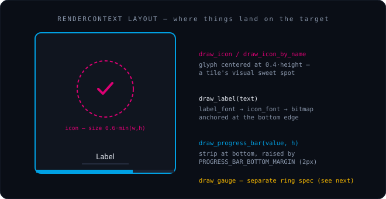

# Icons

`DrawIconOps` renders font glyphs as icons — the crate never does
name resolution itself. Icon names become codepoints through a
**caller-provided `resolve` closure**; fonts arrive as `&FontVec`
parameters (loading and caching stay with the consumer).

<figure class="diagram">
  
  <figcaption>the tile layout RenderContext settles on — icon above, label and strip below</figcaption>
</figure>

## Four entry points

```rust
use smearor_commons_drawing::prelude::*;
use smearor_commons_geometry::{Grid, Pixels, Vec2};

// by name — resolves "folder" → '\u{f07b}' through the caller's map
target.draw_icon(Icon::new(
    Some(&icon_font), "folder", true, &resolve_codepoint, None,
))?;

// unresolved or font-less draws the placeholder glyph instead of nothing
target.draw_icon_placeholder(true, None)?;

// explicit codepoint + exact placement
target.draw_codepoint(Codepoint::new(
    &icon_font, '\u{f07b}', Vec2::<Pixels, f32>::new(32.0, 40.0),
    Pixels::new(48.0), color,
))?;

// a grid of named icons — one codepoint per cell
target.draw_icon_grid(IconGrid::new(&icon_font, &names, grid, false, &resolve_codepoint))?;
```

- `Icon<'a>` — `name`, `is_active` (drives the target's
  `default_text_color`), `resolve`, optional `font` and `color`
- `Codepoint<'a>` — the fully-resolved form: `font`, `codepoint`,
  `center`, `size`, `color`
- `IconGrid<'a>` — `icons: &[&str]` + a geometry `Grid`; unresolved
  names get the placeholder treatment per cell

## The scale-fit cache

Glyph metrics come from `smearor_commons_font`'s
`glyph_fit_scale` — and repeated icon renders are expensive to re-probe.
The `tech` layer keeps a **thread-local cache** keyed by
`(GlyphId, target_px)`, so a tile grid re-rendering the same icon at
the same size probes the glyph outline once.
