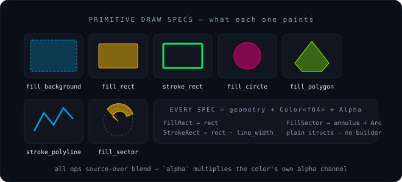

# Primitives

`DrawPrimitiveOps` covers surface fills and the shape vocabulary —
each method takes a plain **spec struct**: geometry + `Color<f64>` +
`Alpha`.

<figure class="diagram">
  
  <figcaption>every spec = geometry + color + alpha — no builder, no state</figcaption>
</figure>

## The vocabulary

```rust
use smearor_commons_color::{Alpha, Color};
use smearor_commons_drawing::prelude::*;
use smearor_commons_geometry::{Circle, Pixels, Rect, Vec2};

// impl Into<Color<u8>> — the one method without a spec
target.fill_background(Color::<u8>::new_rgba(10, 14, 22, 255))?;

let rect: Rect<Pixels> = Rect::from_xywh(10.0, 10.0, 60.0, 30.0);
target.fill_rect(FillRect::new(rect, Color::new_rgba(0.0, 0.63, 0.89, 1.0), Alpha::OPAQUE))?;

let circle: Circle<Pixels> = Circle::new(Vec2::new(45.0, 30.0), 12.0);
target.fill_circle(FillCircle::new(circle, Color::new_rgba(0.86, 0.0, 0.45, 1.0), Alpha::new(0.6)))?;
```

| Spec | Geometry | Extra fields |
|---|---|---|
| `FillRect` | `Rect<Pixels>` | — |
| `StrokeRect` | `Rect<Pixels>` | `line_width` — centered on the edge |
| `FillCircle` | `Circle<Pixels>` | — |
| `StrokeCircle` | `Circle<Pixels>` | `line_width` — centered on the radius |
| `StrokeArc` | `Circle<Pixels>` + `Arc` | `line_width`, `cap` — the rim interval (level bars, progress rings) |
| `FillPolygon` | `Polygon<Pixels>` | even-odd fill |
| `StrokePolygon` | `Polygon<Pixels>` | `line_width`; closed ring with a joined seam |
| `StrokePolyline` | `Polyline<Pixels>` | `line_width`, `cap`; the path stays **open** |
| `FillSector` | `Annulus<Pixels>` + `Arc` | pie-ring wedges |
| `StrokeSector` | `Annulus<Pixels>` + `Arc` | `line_width`; the closed sector boundary |
| `FillSectors` | `Annulus<Pixels>` + `Arc` | `count` + `gap` partition via `Arc::segments`, `colors` cycled per sector |

Open strokes end with a `Cap` — `Butt` (default, cut at the
endpoint), `Round` (a semicircle past it — the progress-bar look) or
`Square` — styled via `spec.with_cap(...)`.

## Blending policy

All primitives **source-over blend** onto existing pixels — matching
what a cairo backend produces with `set_source_rgba` + `fill`. The
spec's `alpha` composes *with* the color's own alpha channel, so a
half-transparent yellow at `Alpha::new(0.5)` lands at quarter
intensity.

Only the declared pixel area is written: row padding and memory
beyond the view extent stay untouched.
