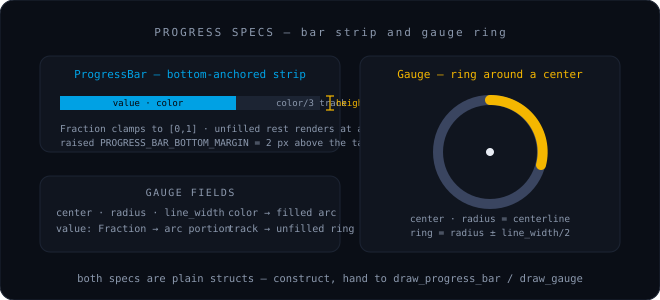

# Text & Progress

`DrawTextOps` and `DrawProgressOps` cover the remaining vocabulary —
labels, positioned text, and the two indicator shapes.

## Text

All three methods take the font as `Option<&FontVec>`; a `None` font
falls back to the raster backend's **built-in bitmap renderer** (cairo
uses its toy text API with system `Sans`). Text rendering never
hard-fails on a missing font.

```rust
use smearor_commons_geometry::{Pixels, Vec2};

// bottom-anchored label — the tile convention
target.draw_label(Some(&font), "Launcher", true, None)?;

// horizontally centered on a baseline
target.draw_text_centered(Some(&font), "42", Pixels::new(80.0), Pixels::new(28.0), color)?;

// baseline at an exact position
target.draw_text(Some(&font), Vec2::<Pixels, f32>::new(8.0, 24.0), "smearor", Pixels::new(14.0), color)?;
```

`draw_label`'s `is_active` flag and `text_color_override` route
through the target's `default_text_color(is_active)` — one anchor for
the crate's color policy, overridable per call or per target.

## Progress

<figure class="diagram">
  
  <figcaption>bar = bottom strip; gauge = ring around a center</figcaption>
</figure>

```rust
use smearor_commons_drawing::prelude::*;
use smearor_commons_color::Color;
use smearor_commons_geometry::{Fraction, Pixels, Vec2};

// full-width strip, anchored 2 px above the target's bottom edge
target.draw_progress_bar(ProgressBar::new(
    Fraction::new(0.68), Color::new_rgba(0.0, 0.63, 0.89, 1.0), Pixels::new(5.0),
))?;

// ring gauge: center, centerline radius, stroke, fraction
target.draw_gauge(Gauge::new(
    Vec2::<Pixels, f32>::new(50.0, 50.0), Pixels::new(30.0), Pixels::new(6.0),
    Fraction::new(0.68), Color::new_rgba(0.96, 0.72, 0.0, 1.0), Color::new_rgba(0.2, 0.25, 0.35, 1.0),
))?;
```

- `ProgressBar` — `value: Fraction` (clamped to `[0,1]` by the
  backends), `color`, `height`. The unfilled rest of the strip renders
  **at a third of the color**; the strip sits
  `PROGRESS_BAR_BOTTOM_MARGIN` (2 px) above the bottom edge.
- `Gauge` — `center`, `radius` (centerline — the ring occupies
  `radius ± line_width/2`), `line_width`, `value`, `color` for the
  filled arc, `track` for the unfilled ring.
