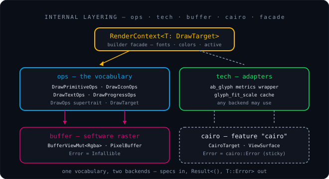

# Traits

The crate's public surface is a **capability vocabulary** — four
traits, each covering one kind of rendering. Backends implement them
incrementally; consumers bound on exactly what they need.

<figure class="diagram">
  
  <figcaption>one vocabulary, two backends — specs in, Result out</figcaption>
</figure>

## `DrawBackend` — one error type per target

The base trait carries a single associated `Error`. That makes error
handling a **property of the target**, not a tax on every call site:

- the software raster (`BufferViewMut<Rgba>`, `PixelBuffer`) uses
  `core::convert::Infallible` — slice writes cannot fail
- `CairoTarget` uses `cairo::Error`, preserving cairo's *deferred*
  error semantics: a failed surface reports the same sticky error on
  every subsequent call

## The four capability traits

| Trait | Methods | Paints |
|---|---|---|
| `DrawPrimitiveOps` | `fill_background`, `fill_rect`, `stroke_rect`, `fill_circle`, `fill_polygon`, `stroke_polyline`, `fill_sector` | surfaces & shapes |
| `DrawIconOps` | `draw_icon`, `draw_icon_placeholder`, `draw_codepoint`, `draw_icon_grid` | font glyphs as icons |
| `DrawTextOps` | `draw_label`, `draw_text_centered`, `draw_text` | text runs |
| `DrawProgressOps` | `draw_progress_bar`, `draw_gauge` | indicators |

`DrawOps` is the umbrella supertrait (blanket-implemented) — bound on
it when a consumer wants the whole vocabulary. `DrawTarget` adds
`size()` plus `default_text_color(is_active)` — the single anchor for
the crate's color policy, and `status()` for sticky-error backends.

## `&mut T` composes

Every capability trait is also implemented for `&mut T` — so
`&mut PixelBuffer` can itself serve as a `DrawTarget` without ceremony.

## `prelude`

Method calls need the declaring trait in scope.
`use smearor_commons_drawing::prelude::*;` brings in all traits plus
the spec structs at once — the intended consumer import.
