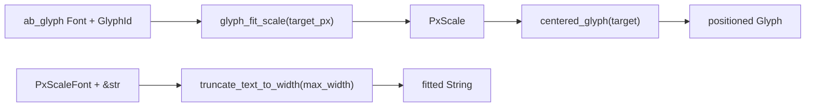

# smearor-commons-font

Font metric utilities on `ab_glyph` fonts — the pure computations only;
font loading and caching policy stay with the consumer. All results are
expressed in `smearor-commons-geometry` units (`Pixels`, `Vec2`,
`Rect`).

- `glyph_fit_scale` — the `PxScale` that fits a glyph into a target
  pixel box.
- `centered_glyph` — positions a glyph so its bounds center inside a
  target point.
- `truncate_text_to_width` — shortens text with an ellipsis until it
  fits a maximum pixel width.

See the crate's rustdoc for the full API.
