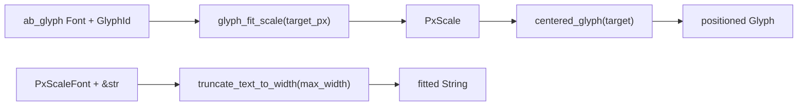

# smearor-commons-font

Font metric utilities on `ab_glyph` fonts — the pure computations
only; font loading and caching policy stay with the consumer. All
results are expressed in `smearor-commons-geometry` units (`Pixels`,
`Vec2`, `Rect`).

## What's inside

- [Glyph Fit](./font/glyph-fit.md) — `glyph_fit_scale`: the `PxScale`
  that makes a glyph's *rendered* size equal `target_px`
- [Centering](./font/centering.md) — `centered_glyph`: position the
  glyph's `px_bounds` center on a target point
- [Truncation](./font/truncation.md) — `truncate_text_to_width`: the
  longest string prefix that fits a pixel width

Three functions, one job each — `smearor-commons-drawing` builds its
icon pipeline on them (`Codepoint.center`, the glyph scale cache,
label rendering). See the crate's rustdoc for the full API.
