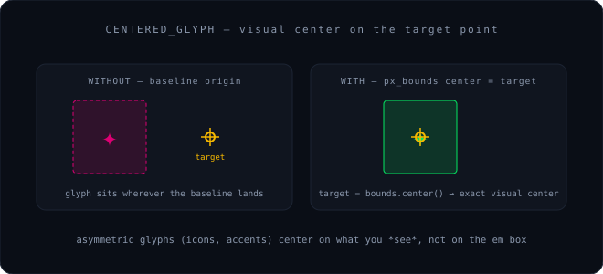

# Centering

`centered_glyph` positions a scaled glyph so that the **center of its
pixel bounds** lands on a target point — the visual center, not the
em-box center.

<figure class="diagram">
  
  <figcaption>asymmetric glyphs center on what you see, not on the em box</figcaption>
</figure>

```rust
use ab_glyph::Font;
use smearor_commons_font::centered_glyph;
use smearor_commons_geometry::{Pixels, Vec2};

let glyph = centered_glyph(
    &font, glyph_id, scale,
    Vec2::<Pixels, f32>::new(160.0, 120.0),   // the point to center on
);
// → glyph positioned so bounds.center() == target
```

## The math

`target − bounds.center()` becomes the glyph's position. For the
bounds, `px_bounds` is preferred (precise for centering — it's what
the rasterizer will actually paint); `glyph_bounds` is the fallback
when the glyph has no outline.

## Why it matters for icons

An icon font's glyphs are asymmetric inside their em squares —
a check mark's ink sits low-right, a star sits centered, a bracket
hugs one side. Centering the em square leaves the *visible* glyph
off-center by a different amount per icon. Centering `px_bounds`
normalizes all of them onto the same point — which is exactly what
`Codepoint`'s `center` field in `smearor-commons-drawing` expects.
