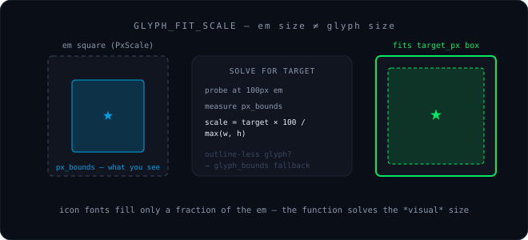

# Glyph Fit

`glyph_fit_scale` answers the question every icon renderer asks:
**which `PxScale` makes this glyph exactly `target_px` big?**

<figure class="diagram">
  
  <figcaption>PxScale sets the em size — icon glyphs fill only a fraction of it</figcaption>
</figure>

```rust
use ab_glyph::{Font, GlyphId};
use smearor_commons_font::glyph_fit_scale;
use smearor_commons_geometry::Pixels;

let em = glyph_fit_scale(&font, glyph_id, Pixels::new(48.0));
// → the em size whose *rendered* glyph spans 48 px in its largest dimension
```

## Why a solver at all

`PxScale` sets the **em** size, not the glyph size. Icon fonts
typically occupy a fraction of the em square — asking for `PxScale
48` renders a glyph visibly smaller than 48 px, and the ratio differs
per glyph. So the function measures instead of guessing:

1. probe the glyph at a fixed `100 px` em — large enough for integer
   `px_bounds` precision
2. take `max(width, height)` of the outlined pixel bounds
3. solve proportionally: `scale = target_px × 100 / max`

A glyph with no outline (`outline_glyph` returns `None`) falls back to
`glyph_bounds` — design space, not pixel-accurate, but the best
available estimate.

## Where it's used

`smearor-commons-drawing` caches exactly this computation in its
`tech` layer — a thread-local map keyed by `(GlyphId, target_px)`, so
a tile grid re-rendering the same icon at the same size probes the
glyph once.
