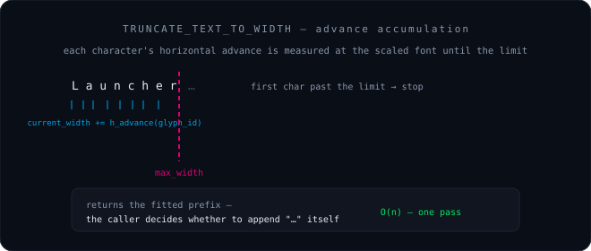

# Truncation

`truncate_text_to_width` shortens a string until it fits a maximum
pixel width at a given scaled font — the label-overflow primitive for
tight surfaces like tiles and list rows.

<figure class="diagram">
  
  <figcaption>per-character h_advance accumulates until the limit is crossed</figcaption>
</figure>

```rust
use ab_glyph::Font;
use smearor_commons_font::truncate_text_to_width;
use smearor_commons_geometry::Pixels;

let scaled = font.as_scaled(PxScale::from(14.0));
let fitted = truncate_text_to_width("Launcher Settings", &scaled, Pixels::new(96.0));
// → "Launcher S" or whatever fits — measured, not estimated
```

## How it measures

One pass, O(n): each character's `glyph_id` is looked up on the scaled
font and `h_advance` accumulates into `current_width`. The first
character that would exceed `max_width` stops the loop — the function
returns the longest prefix that fits.

## No ellipsis built in

The function returns the fitted prefix **as-is** — it does not append
`…` itself. That's deliberate: the caller decides whether to show a
truncation indicator, which character to use (`…`, `…`, a fade), or
whether a shorter string at a smaller font is preferable. Appending
the ellipsis is a one-liner on the consumer side; taking it back would
be impossible.

## Input

`scaled_font: &PxScaleFont<&F>` — borrow a scaled view of any
`ab_glyph::Font` (`font.as_scaled(px)`) rather than scaling the font
itself, so the same `FontVec` serves label and icon sizes alike.
