# Fx

`smearor-commons-fx` is a headless, serializable per-pixel effect
library - the Rust analogue of Burn-My-Windows' shader effects,
generalized to any rectangular content a consumer can snapshot into
a `PixelBuffer<Rgba>` (widgets, cards, sprites).

Effects animate **textures, not widgets**: the consumer snapshots its
content once, hands it over as `ctx.window`, and plays the animation
as a frozen texture while the real widget stays hidden. Layout,
geometry and z-order remain the consumer's responsibility.

The crate is clock-free: `FxContext.progress` arrives pre-eased from
a `TimedAnimation` driven by the consumer.

- [Context](./fx/context.md) - the uniform block (`FxContext`,
  `Direction`, `Layer`, `Layers`)
- [Params](./fx/params.md) - the `ParamSpec`/`ParamKind`/`ParamValue`
  metadata model
- [Spec](./fx/spec.md) - `EffectSpec`, the serde-tagged dispatch root

## Shipped effects

| Nick | Effect | Mechanism |
|---|---|---|
| `crossfade` | `Crossfade` | Reference effect - plain alpha blend (Phase 1). |
| `glide` | `Glide` | UV transform (scale, squish, tilt, shift) + dissolve. |
| `pixel-wheel` | `PixelWheel` | Pixelation + angular spoke wipe. |
| `fire` | `Fire` | Fractal-noise burn front with a 5-stop flame ramp. |
| `matrix` | `Matrix` | Glyph rain + trail composite over a falling window mask; glyphs come from a `GlyphSource` (bundled `ProceduralGlyphAtlas` with an embedded 5x7 bitmap font). |
| `aura-glow` | `AuraGlow` | Radial blur + cos-palette glow + superellipse crop. |
| `doom` | `Doom` | Pixelated column melt (DOOM screen melt). |
| `apparition` | `Apparition` | Shake + suction + whirl dematerialization. |
| `portal` | `Portal` | Five-layer swirl portal + window travel. |
| `tv` | `Tv` | CRT collapse to the center line. |
| `tv-glitch` | `TvGlitch` | CRT collapse overlaid with glitch rows. |
| `glitch` | `Glitch` | Row shear + interference + grain + RGB split. |
| `venetian-blinds` | `VenetianBlinds` | Turning or folding horizontal slats. |
| `shredder` | `Shredder` | Falling paper strips with torn edges. |
| `materialize` | `Materialize` | Quantized panel growth + tint reveal. |
| `energize-a` | `EnergizeA` | Radial atom burst dissolve. |
| `energize-b` | `EnergizeB` | Top-down shower + streak + atom dissolve. |
| `rgbwarp` | `RgbWarp` | Vertical channel-split peel + brightness pulse. |
| `mushroom` | `Mushroom` | 8-bit scale + rising sparks + rays + star rings. |
| `pixelate` | `Pixelate` | Cell-dropout pixel dissolve. |
| `pixel-wipe` | `PixelWipe` | Radial pixel wipe from the pointer (window center when absent). |
| `hexagon` | `Hexagon` | Shrinking hexagonal tiles + glow lines, additive or over-blended. |
| `incinerate` | `Incinerate` | Fiery-edge burn from the pointer or a random edge, with smoke and embers. |
| `wisps` | `Wisps` | Orbiting light dots + shrinking noise dissolve. |
| `team-rocket` | `TeamRocket` | Window warp toward a sparkle position + rotating superellipse star flare. |
| `trex` | `Trex` | Claw-scratch strips (`FxAssets::claws` or a procedural fallback) + flash color, finite-difference warp. |
| `snap` | `Snap` | Voronoi-grouped dust disintegration with wind (`FxAssets::dust` or fallback). |
| `paint-brush` | `PaintBrush` | Left-to-right brush-stroke sweep revealing/erasing the window (`FxAssets::brush` or fallback). |
| `broken-glass` | `BrokenGlass` | Shattered shard layers blowing away with gravity (`FxAssets::shards` or fallback). |
| `aperture-panels` | `AperturePanels` | Two-pass panel grid flipping the window in/out over a backdrop (transparent, black, star field, nebula; cake easter egg). |
| `morph` | `Morph` | Two-pass curl-noise flow, edge-guided melt, or shared-grid pixelate morph. |
| `wormhole` | `Wormhole` | Two-pass rubber-sheet funnel with the window pushed out of a void, with bounce. |
| `focus` | `Focus` | Radial blur cone (`blur_amount` px radius, `blur_quality` taps/ray) resolving while the window fades in. |

All 33 are reachable through `EffectSpec::by_nick`/`build` and
survive JSON round trips. Each rustdoc states the behavioral spec and
names its source shader in the Burn-My-Windows checkout for
provenance; the implementations are semantic re-implementations on our
ops (`mix`, `smoothstep`, `absolute_edge_mask`, `relative_edge_mask`,
`offset_hue`, `whirl`, `darken`, `lighten`, `alpha_over`, `tritone`,
`BufferView` sampling), not line ports.

## Effect assets

`FxContext::assets` (`FxAssets`) is the channel through which consumers
hand optional texture atlases to the five asset-driven effects
(`trex`, `snap`, `paint-brush`, `broken-glass`, and any future
atlas effect). Each slot (`claws`, `dust`, `brush`, `shards`) is an
`Option`al `BufferView` sampler; when empty the effect falls back to a
deterministic procedural map, so headless consumers render correctly
without packaged image files while GTK consumers can pass the real
Burn-My-Windows PNGs.

## Two-pass effects

Three effects (`aperture-panels`, `morph`, `wormhole`) declare
`Layers::SurfaceAndWindow` - Burn-My-Windows' `uLayer` architecture.
The consumer runs `apply` twice per frame: once with
`ctx.layer = Layer::Surface` (the backdrop pass reading
`ctx.surface`), once with `Layer::Window`, and composites window
over surface. `WindowEffect::check` returns
`FxError::MissingSurface` when a two-pass effect runs without
`ctx.surface`; `apply` itself degrades gracefully to transparent
reads so headless consumers can still drive the window pass alone.

## The `fx` experimenter

`cargo run -p smearor-commons-fx --features gtk4 --example fx` opens
the GTK experimenter - the same grammar as the animation examples:
a rendered test card on the left, generated controls on the right,
playback and effect serialization at the bottom.

The right panel is **metadata-driven**: every `ParamKind` maps to one
widget (`Float` -> `Scale`, `Int` -> `SpinButton`, `Toggle` ->
`CheckButton`, `Color` -> `ColorDialogButton`, `Choice` ->
`DropDown`), so no per-effect UI is written by hand.

The test card is a fixed `PixelBuffer<Rgba>` rendered through
`smearor-commons-drawing` - a floating-board card *on
transparency*: every pixel outside the card rect keeps `a = 0` and
only the card's own soft shadow carries alpha. The desktop gradient
is compositor-owned (`common::desktop`); per frame the canvas shows
`out` source-over `desktop`, exactly the split a real compositor
makes when it hands a window snapshot to an effect.

Save/Load/Emit speak the shared `Effect` envelope:

```json
{
  "demo": "fx",
  "object": "fire",
  "options": { "scale": 1.0, "direction": "close", "seed": 42 },
  "duration_secs": 1.6,
  "components": []
}
```

`options` is the serde-flattened `EffectSpec` payload plus
`direction`/`seed`, so a saved effect replays deterministically.
Emit generates a `serde_json` spec constructor plus a ready
`FxContext`/`apply` skeleton (`<name>.rs` next to the JSON path).

The test card itself - a floating-board window mock with the
Smearor tile mark - regenerates via `cargo run -p
smearor-commons-fx --features gtk4 --example dump_card`:


Rendered frames (all deterministic for a fixed seed/progress) come
from `cargo run -p smearor-commons-fx --features gtk4 --example dump_frame -- <effect> <progress> <direction>`:

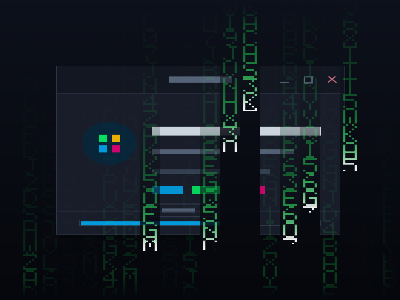 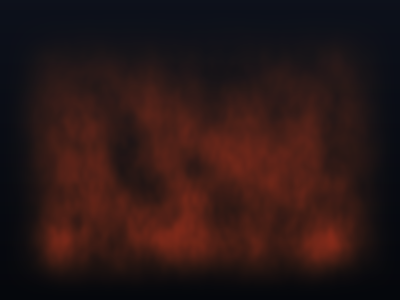 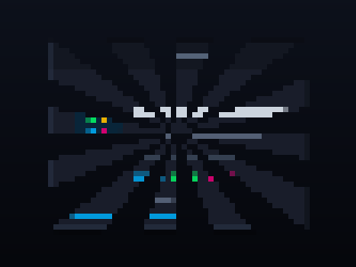 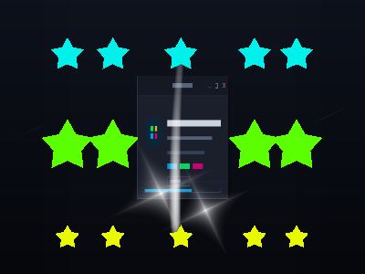 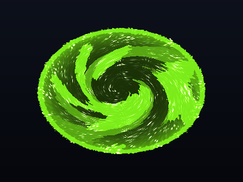 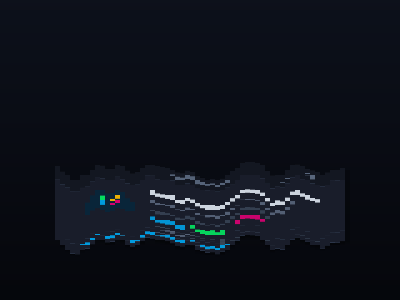 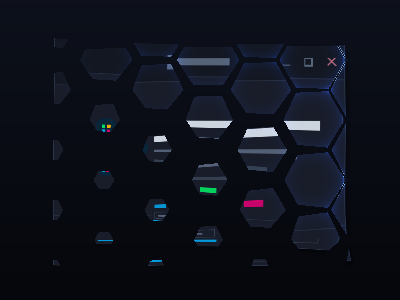 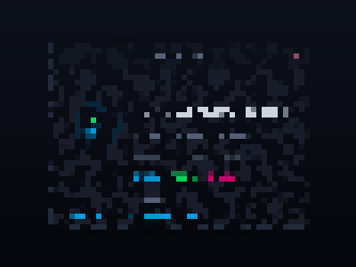 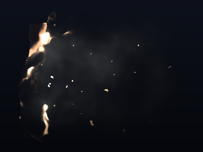 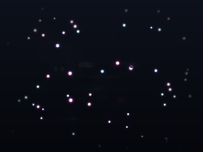 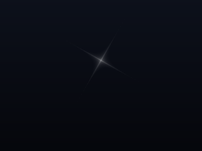 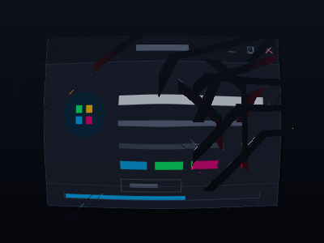 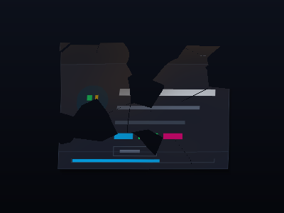 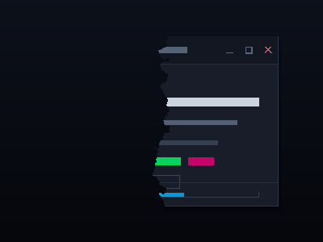 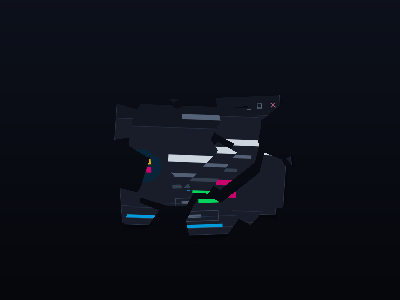 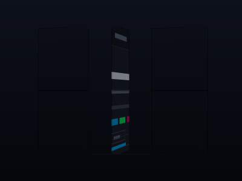 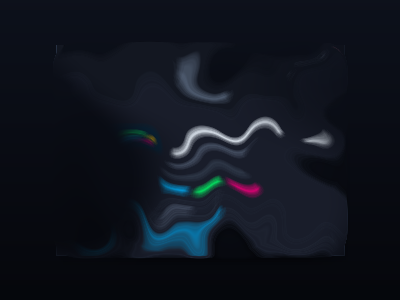 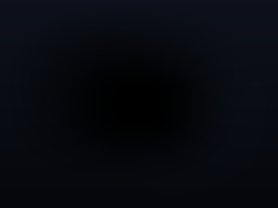 
