# smearor-commons-geometry

Generic 2D geometry primitives: unit-tagged vectors, rotations,
rectangles and shapes — pure mathematics without framework
dependencies.

## One model, two roles

`Vec2<U, T>` and `Rect<U, T>` are generic over the coordinate space `U`
(a zero-cost phantom marker, e.g. `Millimeters` or `Pixels`) *and* the
numeric component type `T` (default `f64`). `Vec2<Millimeters>` is a
tagged domain point; `Vec2<(), i32>` is the *unit-erased* boundary form
that converts into whatever a framework expects. `Position`, `Size` and
`Rectangle` are readable aliases for the erased forms — the same type,
not parallel representations.

```mermaid
flowchart LR
    subgraph tagged["Unit-tagged (domain math)"]
        mm["Vec2&lt;Millimeters&gt;"]
        px["Rect&lt;Pixels&gt;"]
    end
    subgraph erased["Unit-erased U = () (boundaries)"]
        i32v["Vec2&lt;&#40;&#41;, i32&gt;"]
        f32v["Rect&lt;&#40;&#41;, f32&gt;"]
    end
    subgraph frameworks["Framework types (feature-gated)"]
        graphene["graphene::Rect (gtk4)"]
        smithay["smithay Rectangle"]
        cairo["cairo::RectangleInt (cairo)"]
        abg["ab_glyph::Rect (ab_glyph)"]
    end
    mm --> i32v
    px --> f32v
    f32v --> graphene
    i32v --> smithay
    i32v --> cairo
    f32v --> abg
```

## What's inside

- **Shapes**: `Line`, `Segment`, `Circle`, `Annulus`, `Arc`, `Polyline`,
  `Polygon` — `Circle` e.g. rasterizes itself into 1-px `Rect<U, i32>`
  strips (`region_rects`) or a cairo `Region` behind the `cairo` feature.
- **Quantities**: `RotationRad`, `Rotation`, `QuarterTurn`,
  `RotationDirection`, `Fraction`, `AspectRatio`, `ScaleFactor`,
  `SmoothingAlpha` — strict newtypes with `FromStr`/`Display` where it
  fits.
- **Units**: `Millimeters`, `Pixels`, `SquareMillimeters`,
  `PixelsPerMm`, `UnitsPerMm`, `Degrees`, `DegreesPerPixel`, `Radians`.
- **Grid**: `Grid`/`Partition` with `Cell`/`Col`/`Row` for cell-addressed
  partitions.
- **Transforms**: `RigidTransform`, `SimilarityTransform` — `gtk4` adds
  `CenteredTransform` and `WidgetSizeExt`.
- **Serde adapters**: `serde_pair`, `serde_pair_option`, `serde_points`
  serialize `Vec2`s as compact `[x, y]` pairs.
- **Rasterization**: `Scanline` strips from `Rect::rotated_region_scanlines`
  and `Circle::region_rects`.

Feature gates: `async-graphql`, `schemars`, `zbus`, `ab_glyph`, `gtk4`,
`cairo`, `smithay`. See the crate's rustdoc for the full API.
