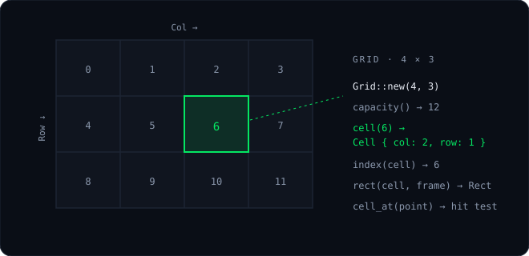
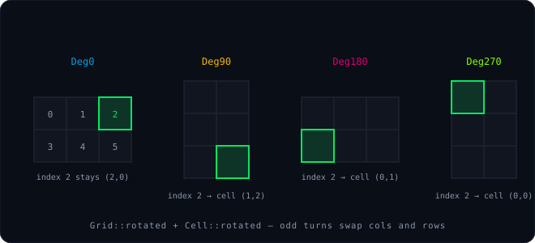

# Grid

`Grid` partitions an extent into `cols × rows` equal cells. The grid
itself is **unit-free** — pure integer index bookkeeping, like a field
number on a chess board — and resolves to real `Rect`s only when you
hand it a `Vec2<U, T>` extent.

<figure class="diagram">
  
  <figcaption>row-major indices ↔ Cell { col, row } ↔ Rect in a caller-supplied extent</figcaption>
</figure>

```rust
use smearor_commons_geometry::{Cell, Col, Grid, Row};

let grid = Grid::new(4, 3);           // 4 columns × 3 rows
grid.capacity();                      // 12
grid.cell(6);                         // Some(Cell { col: 2, row: 1 })
grid.index(Cell::new(Col(2), Row(1)));// Some(6)
Grid::for_items(10, 4);               // enough rows for 10 items at 4 cols
```

`Col` and `Row` are distinct newtypes — swapping column and row is a
compile error, not a silent transpose.

## Resolving cells to geometry

Give the grid an extent and it hands back geometry in that space:

```rust
use smearor_commons_geometry::{Cell, Col, Grid, Pixels, Rect, Row, Vec2};

let grid = Grid::new(4, 3);
let frame: Vec2<Pixels> = Vec2::new(800.0, 600.0);

grid.cell_size(frame);                                  // one cell: 200×200 px
grid.rect(Cell::new(Col(2), Row(1)), frame);            // the cell's Rect<Pixels>

// hit testing: which cell did the touch land in?
let bounds: Rect<Pixels> = Rect::from_xywh(0.0, 0.0, 800.0, 600.0);
grid.cell_at(Vec2::new(250.0, 150.0), bounds);          // Some(Cell { col: 1, row: 0 })
grid.index_at(Vec2::new(250.0, 150.0), bounds);         // Some(1)
```

`rect_within(cell, frame)` does the same as `rect` against a `Rect`
frame instead of a bare extent; integer extents leave the division
remainder unassigned at the right/bottom edge rather than drifting
cells.

## Rotating the board

`Grid::rotated(turn)` returns the grid *as seen* after a quarter turn —
odd turns swap `cols` and `rows` — and `Cell::rotated(turn, &grid)` /
`Grid::rotate_cell` map each cell into the rotated frame:

<figure class="diagram">
  
  <figcaption>cell (2,0) in a 3×2 grid → (1,2) at Deg90, (0,1) at Deg180, (0,0) at Deg270</figcaption>
</figure>

```rust
use smearor_commons_geometry::{Cell, Col, Grid, QuarterTurn, Row};

let grid = Grid::new(3, 2);
let rotated = grid.rotated(QuarterTurn::Deg90);          // becomes 2×3
grid.rotate_cell(QuarterTurn::Deg90, Cell::new(Col(2), Row(0)));
// → Cell { col: 1, row: 2 } — valid inside `rotated`
```

Pair the two: `cell.rotated(turn, grid)` always addresses into
`grid.rotated(turn)`. This is how a board layout survives being
re-oriented for a player on another table edge — the *indices* of the
game state never change, only the frame they are drawn in.
