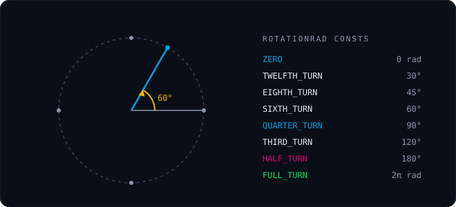
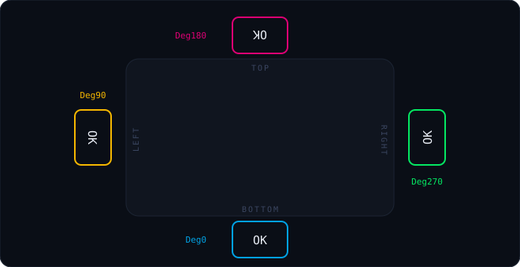

# Quantities

Scalar newtypes that make *what kind of number* part of the type:
progress fractions, angles, ratios, smoothing factors. All are
`Copy`, `serde`-transparent, and several understand `FromStr`/`Display`.

## Fraction — progress and blends

`Fraction(pub f64)` is a progress value — deliberately *not* clamped:

```rust
use smearor_commons_geometry::Fraction;

let t = Fraction::new(0.5);       // Fraction::HALF
t.clamped();                      // squeeze into 0.0..=1.0
t.inverse();                      // 1 - t
```

Animations may extrapolate past `1.0` (an overshoot easing); each
consumer decides what out-of-range values mean. `clamped()` is the
explicit opt-in for the closed interval.

## RotationRad — continuous angles

`RotationRad(pub Radians)` is the continuous angle. Everything
directional in the crate — `Vec2::direction`, `Segment::direction`,
`Arc`, transforms — speaks `RotationRad`, so there is never a
degrees/radians mix-up at a call site.

<figure class="diagram">
  
  <figcaption>continuous angles with named turn constants</figcaption>
</figure>

```rust
use smearor_commons_geometry::RotationRad;

let angle = RotationRad::from_degrees(45.0);   // or RotationRad::EIGHTH_TURN
let normalized = angle.rotated_degrees(400.0).normalized(); // back into [-π, π)
let delta = angle.signed_delta_to(RotationRad::QUARTER_TURN); // shortest signed step
let smoothed = RotationRad::ema(old, new, alpha); // angular EMA — handles wraparound
```

Beyond conversion (`to_degrees`, `degrees()`, `radians()`, `as_f64`,
`sin_cos`) it knows about *axis angles*: `axis()` folds a direction
onto the unoriented axis (`0..π`), `axis_delta_to` gives the shortest
axis delta — for elements where 0° and 180° mean the same thing
(e.g. an unrotated card back).

## QuarterTurn — snapped orientation

`QuarterTurn` is the discrete enum `Deg0 | Deg90 | Deg180 | Deg270` —
exactly the four orientations a tabletop card can readably face.

<figure class="diagram">
  
  <figcaption>four orientations, one per table edge</figcaption>
</figure>

```rust
use smearor_commons_geometry::QuarterTurn;

let turn = QuarterTurn::Deg90;
turn.clockwise();           // Deg180
turn.counter_clockwise();   // Deg0
turn.inverse();             // Deg270
turn.swaps_axes();          // true — width and height trade places
turn.degrees();             // 90.0
turn.to_rotation_rad();     // continuous form
QuarterTurn::ALL;           // [Deg0, Deg90, Deg180, Deg270]
```

Snapping helpers: `snap_zone(angle)` returns the nearest quarter turn,
`snap_target(angle, direction)` the next quarter turn *in a given
direction* — the difference between "where would it settle" and "which
way is it spinning". `from_degrees`/`from_rotation_rad` return `Option`
since only exact multiples of 90° qualify.

`apply(pos, bounds)` maps a point through the quarter turn inside
`bounds` — the coordinate math every tabletop needs when content is
re-oriented for another seat.

## SixthTurn & EighthTurn — finer snaps

`SixthTurn` (`Deg0`…`Deg300` in 60° steps) and `EighthTurn`
(`Deg0`…`Deg315` in 45° steps) are the snapped orientations of regular
hexagons and octagons — every sixth turn maps a `Hexagon` onto itself,
every eighth turn an `Octagon`. They mirror the `QuarterTurn` API:

```rust
use smearor_commons_geometry::{EighthTurn, RotationDirection, RotationRad, SixthTurn};

SixthTurn::Deg60.clockwise();                          // Deg120
SixthTurn::Deg60.inverse();                            // Deg240
EighthTurn::snap_zone(RotationRad::from_degrees(100.0)); // Deg90
SixthTurn::snap_target(angle, RotationDirection::Clockwise); // next step along the drag
SixthTurn::ALL;                                        // all six, clockwise
```

`snap_zone(angle)` returns the nearest step (zones reach 30° resp.
22.5° to either side of each turn's angle), `snap_target(angle,
direction)` the next step *along* a drag direction — the same
mechanics [RotationSnap](../animation/rotation-snap.md) drives for
quarter turns. `from_degrees`/`from_rotation_rad` return `Option`
since only exact multiples qualify.

## Rotation — snapped *or* free

`Rotation` is the union enum for values that are *usually* a snapped
turn but sometimes continuous — e.g. a card mid-spin. Four variants:
`QuarterTurn`, `SixthTurn`, `EighthTurn` and `Free(RotationRad)`.

```rust
use smearor_commons_geometry::{QuarterTurn, Rotation, RotationRad};

let r = Rotation::from_degrees(90.0);  // Rotation::QuarterTurn(Deg90) — snapped
let f = Rotation::from_degrees(45.0);  // Rotation::Free(RotationRad) — continuous
let q = Rotation::quantized(RotationRad::from_degrees(179.9)); // nearest snap

r.quarter_turn();   // Some(Deg90)
r.sixth_turn();     // None
f.is_snapped();     // false — is_snapped covers all three snapped forms
```

`degrees()`/`to_rotation_rad()` normalize any variant to a continuous
angle. `from_degrees`/`quantized` snap only to `QuarterTurn` — the
finer turns are opt-in via `SixthTurn::from_degrees` /
`EighthTurn::from_degrees` or the variant constructors directly.

## RotationDirection

`RotationDirection::{Clockwise, CounterClockwise}` — with
`RotationDirection::of(delta)` mapping a signed `Degrees` change to a
direction (`None` for zero) and `step(turn)` advancing a `QuarterTurn`
one step along it.

## AspectRatio, ScaleFactor, Factor, SmoothingAlpha

- `AspectRatio` — width/height ratio; `new` rejects non-positive input
  with `Option`, and consts cover the usual suspects (`SIXTEEN_NINE`,
  `FOUR_THREE`, `ISO_PAPER`, `GOLDEN`, …). `Vec2::aspect()` derives one.
- `ScaleFactor(pub f64)` — a zoom factor; `Camera` uses it for
  screen-pixels-per-world-unit.
- `Factor(pub f64)` — a signed, unitless multiplier (`0.0` neutral,
  negative inverts) — the general-purpose sibling of `ScaleFactor`
  for coefficients like tilt, squish or drift speed that are no size
  relation.
- `SmoothingAlpha` — the EMA weight; `is_effective()` tells whether it
  actually smooths, `complement()` is `1-α`, and
  `from_frame_time(frame_time, tau)` derives the per-frame alpha from a
  time constant — the physics of `RotationRad::ema` / `Vec2` smoothing.
