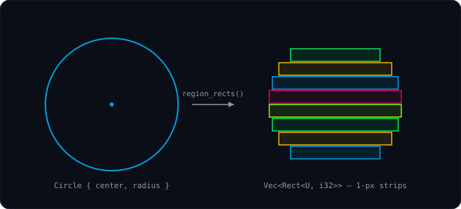
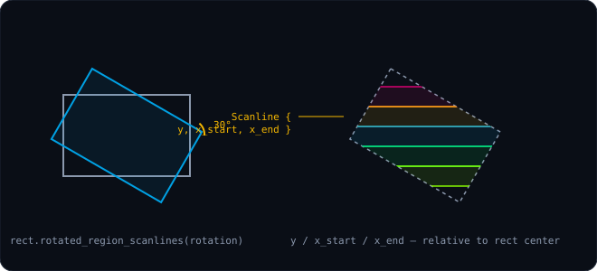

# Rasterization

Analytic shapes describe the ideal geometry; rasterization turns them
into the integer strip/rect decompositions that renderers and damage
trackers actually consume.

## Circle → region_rects

`Circle::region_rects()` decomposes the disc into a `Vec<Rect<U, i32>>`
of 1-px-high horizontal strips — the integer-pixel coverage of the
circle:

<figure class="diagram">
  
  <figcaption>region_rects() — the disc as horizontal strips</figcaption>
</figure>

```rust
use smearor_commons_geometry::{Circle, Vec2};

let disc: Circle = Circle::new(Vec2::new(100.0, 100.0), 40.0);
let strips = disc.region_rects();      // Vec<Rect<(), i32>> around the center
// feature "cairo": disc.region() -> Result<cairo::Region, cairo::Error>
```

Behind the `cairo` feature, `Circle::region()` produces the same
coverage as a `cairo::Region` — ready for `region.intersect_*`
operations and `set_clip_region`.

## Rotated Rect → Scanline strips

`Rect::rotated_region_scanlines(rotation)` answers a subtler question:
which *pixels* does a rotated rectangle cover? It decomposes the
rotated outline into `Scanline { y, x_start, x_end }` runs — y and the
x extents relative to the rect's center:

<figure class="diagram">
  
  <figcaption>a rotated rect decomposed into scanline runs</figcaption>
</figure>

```rust
use smearor_commons_geometry::{Pixels, Rect, RotationRad};

let card: Rect<Pixels> = Rect::from_xywh(0.0, 0.0, 140.0, 90.0);
let strips = card.rotated_region_scanlines(RotationRad::from_degrees(30.0));

for strip in strips {
    // strip.y          — scanline offset from the rect center
    // strip.x_start..x_end — covered x range on that line (inclusive)
    // strip.width()    — run length in pixels
}
```

This is the damage-region primitive: repaint or invalidate exactly the
pixels a rotated card covers, instead of its (much larger) axis-aligned
bounding box — the same representation `cairo::RectangleInt`-style
integer regions use.

## Where it plugs in

The drawing crate consumes these decompositions when it rasterizes
into `smearor-commons-buffer` views: filled circles blit strip by
strip, rotated fills walk scanlines — no floating-point edges reach the
framebuffer.
