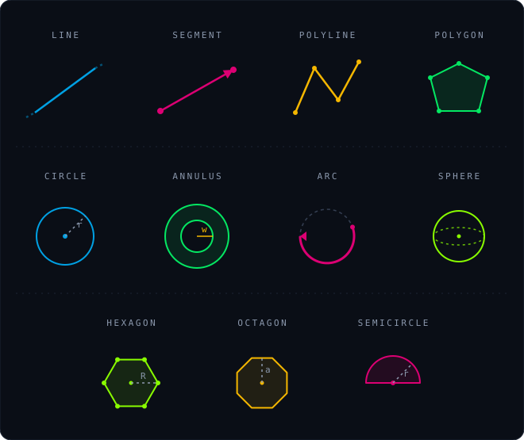
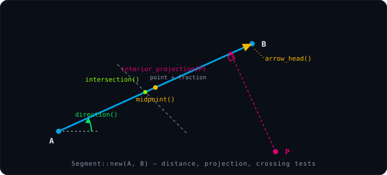

# Shapes

Beyond `Vec2` and `Rect`, the crate ships a set of analytic shapes —
all generic over the coordinate-space unit `U` (and mostly over the
component type `T`, defaulting to `f64`):

<figure class="diagram">
  
  <figcaption>the shape zoo — all generic over the unit U</figcaption>
</figure>

```rust
use smearor_commons_geometry::{Annulus, Circle, Polygon, Segment, Vec2};

let circle: Circle = Circle::new(Vec2::new(50.0, 50.0), 20.0);
let ring: Annulus = Annulus::new(Vec2::new(50.0, 50.0), 12.0, 20.0);
let edge: Segment = Segment::new(Vec2::new(0.0, 0.0), Vec2::new(100.0, 60.0));
```

## Line & Segment

`Line<U>` is the *infinite* line through `origin` along `direction`;
`Segment<U>` is the bounded variant between `from` and `to` — and the
far richer API, since touch traces, edges and rays on a tabletop are
almost always bounded.

<figure class="diagram">
  
  <figcaption>segment anatomy — midpoint, direction, projection, intersection</figcaption>
</figure>

| Method | Returns |
|---|---|
| `midpoint()` | the center `Vec2<U>` |
| `direction()` | heading as `RotationRad` |
| `bounding_box()` | the enclosing `Rect<U>` |
| `interior_projection(p)` | `Projection { point, fraction }`, `None` off the ends |
| `interior_distance(p)` | `Option<U>` — distance when the projection lands inside |
| `nearest(p)` | closest point incl. the end caps |
| `distance(p)` | `U` — always defined |
| `crosses(other)` / `crossing_point(other)` / `intersection(other)` | boolean / point variants of the crossing test |
| `arrow_head(head, half_span)` | a `Polygon<U>` triangle — ready-made arrowheads for direction cues |
| `param_on_line(anchor, axis)` | parameter along an arbitrary axis |

`Projection<U>` (also exported) carries the `fraction` along the
segment — `0.0` at `from`, `1.0` at `to`, deliberately unclamped — plus
the projected `point` itself.

## Polyline

`Polyline<U>` is an *open* vertex list — a touch trace, a drag path, a
wire run. It iterates `segments()`, tests `crosses()` against other
polylines, and processes paths:

- `smoothed(rounds, pinned)` — Chaikin-style corner cutting, with
  `pinned` vertex indices kept fixed
- `resampled(count)` — even arc-length resampling
- `offset(distance)` — a parallel copy, e.g. for stroke outlines
- `arc_length(at)` / `nearest_segment(p)` / `axis_param(...)` —
  measuring along and against the path
- `smoothed_anchored(anchors, within, rounds)` — smoothing that snaps
  nearby vertices onto anchor points (magnetic endpoints)

## Polygon

`Polygon<U>` is the *closed* variant — last vertex connects back to the
first. Containment (`contains`, `contains_or_touches`), `centroid`,
`bounding_box`, `is_simple` (self-intersection test), `crossed` by a
segment, `overlaps` another vertex list.

The `Millimeters` specialization adds tabletop-specific queries:
`signed_area()` → `SquareMillimeters`, `chord(point, axis)` — the cut
of a line through the body — and `deepest_point` /
`deepest_point_avoiding(others)` for placing labels inside an irregular
region away from obstacles. `offset(distances)` grows or shrinks each
edge individually.

```rust
use smearor_commons_geometry::{Polygon, Segment, Vec2};

let table_zone: Polygon = Polygon::new(vec![
    Vec2::new(0.0, 0.0),
    Vec2::new(300.0, 0.0),
    Vec2::new(280.0, 180.0),
    Vec2::new(20.0, 180.0),
]);
if table_zone.contains(&Vec2::new(150.0, 90.0)) {
    // point inside the play area
}
```

## Circle & Annulus

`Circle<U, T>` stores `center` + `radius`. Beyond `contains`/`overlaps`/
`bounding_box`, it exposes both *unit-typed* accessors (`radius_unit`,
`diameter`, `circumference`) and `f64` bridges (`diameter_f64`,
`circumference_f64`) — so the same type serves mm-precise surface math
and framework float APIs. `area::<P>()` is generic over the return
type. `inscribed_square_side()` / `with_inscribed_square(center, side)`
convert between the circle and the largest centered axis-aligned square
inside it — a vocabulary `Hexagon`, `Octagon` and `Semicircle` share.

`Annulus<U, T>` is a ring: `center`, `inner`, `outer` radii. `width`
(ring thickness), `mid_radius`, `contains` (inside the outer, outside
the inner), and `inner_circle`/`outer_circle` views. A radial gauge
track or a ring-shaped touch zone is an `Annulus`.

Both rasterize — see [Rasterization](rasterization.md).

## Arc

`Arc` is an *angular* interval, not a spatial one — it is not generic
over `U` because it lives on the circle of directions:

```rust
use smearor_commons_geometry::{Arc, RotationRad};

let wedge = Arc::new(RotationRad::from_degrees(30.0), RotationRad::from_degrees(60.0));
wedge.contains(RotationRad::from_degrees(45.0)); // true
wedge.end();          // 90°
wedge.midpoint();     // 60°
wedge.at(smearor_commons_geometry::Fraction::HALF); // parameter → direction
```

`Arc::spanning(from, to)` computes the interval between two
directions; `Arc::gaps_between(&[RotationRad])` returns the angular
holes between sorted directions — used e.g. to find free angular slots
around a dial (and by `OrbitLayout` in the layout crate to place items
between anchor directions).

## Regular polygons — Hexagon & Octagon

`Hexagon<U, T>` and `Octagon<U, T>` model the regular n-gons a
hexagonal grid, a pie-menu ring or a compass dial is built from. Both
store `center` + `circumradius` (center to vertex) plus a
`PolygonOrientation` — `FlatTop` (a horizontal top edge) or
`PointyTop` (a vertex on top).

```rust
use smearor_commons_geometry::{Hexagon, Octagon, PolygonOrientation, Vec2};

let tile = Hexagon::flat_top(Vec2::new(100.0, 80.0), 40.0);
let cell = Hexagon::with_inradius(Vec2::new(0.0, 0.0), 17.3, PolygonOrientation::PointyTop);
let dial = Octagon::with_side_length(Vec2::new(50.0, 50.0), 24.0, PolygonOrientation::FlatTop);
```

Every extent works in both directions — `with_side_length`/
`side_length`, `with_inradius`/`inradius` (the apothem, `R·sin(60°)`
for the hexagon, `R·cos(22.5°)` for the octagon; the hexagon's side
length *is* its circumradius). Common queries:

- `vertices()` — the corners in counter-clockwise order;
  `to_polygon()` is the bridge into generic `Polygon` algorithms
- `contains(p)`, `bounding_box()`, `support(direction)` — the exact
  convex support function (largest vertex projection)
- `inscribed_square_side()` / `with_inscribed_square(center, side,
  orientation)` — the largest centered axis-aligned square inside,
  and its exact inverse

`PolygonOrientation` is a two-variant enum with `Display`/`FromStr`
(`flat-top` / `pointy-top`) — and the symmetry vocabulary the snapped
rotations quantize into: `SixthTurn` maps a hexagon onto itself,
`EighthTurn` an octagon.

## Semicircle

`Semicircle<U, T>` is a half-disk — a dome standing on its diameter
edge through `center`, extending toward smaller `y` in the usual
screen convention:

- `contains(p)` — inside the virtual circle *and* on the dome side of
  the flat edge
- `bounding_box()` — `2r` wide, `r` tall, the flat edge at the bottom
- `support(direction)` — `r` into the dome half, `r·|cos|` along the
  flat edge
- `inscribed_square_side()` / `with_inscribed_square(center, side)` —
  the largest square standing on the diameter edge (`2r/√5`), and its
  inverse

## Sphere & friends

- `Sphere<U, T>` — `Vec3` center + radius; pairs with `Camera`
  (yaw/pitch/scale) for 3D-to-screen projection.
- `Corners<U>` — the four corners of a rect as named fields
  (`top_left`, …), `into_array()` for iteration.
- `Barycentric` — normalized triangle weights; inside-test via
  non-negativity.
