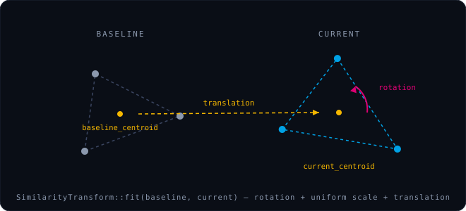

# Transforms

Least-squares fits between two *corresponding* point sets — the
workhorse for multi-touch manipulation. Put N fingers on an object,
store their `baseline` positions, and each frame `fit` the transform
that maps baseline → current.

<figure class="diagram">
  
  <figcaption>fit() solves rotation, uniform scale and translation from corresponding points</figcaption>
</figure>

## RigidTransform — rotate + translate only

`RigidTransform<U>` fits rotation and translation with scale fixed at
`1` — the rigid motion of an object that must not change size:

```rust
use smearor_commons_geometry::{RigidTransform, Vec2};

let baseline = [Vec2::new(0.0, 0.0), Vec2::new(100.0, 0.0), Vec2::new(50.0, 80.0)];
let current  = [Vec2::new(20.0, 40.0), Vec2::new(120.0, 40.0), Vec2::new(70.0, 120.0)];

if let Some(rigid) = RigidTransform::fit(&baseline, &current) {
    let moved_anchor = rigid.apply(Vec2::new(50.0, 40.0)); // baseline space → current space
}
```

Fields: `rotation` (`RotationRad`), `baseline_centroid`,
`current_centroid` — `apply` rotates around the centroids, so the
transform is "carry the baseline centroid to the current centroid,
rotating around it".

## SimilarityTransform — plus uniform scale

`SimilarityTransform<U>` adds a uniform `scale: Fraction` — pinch
gestures. The fit is closed-form: each corresponding pair votes for the
angle weighted by its squared centroid distance, and the scale is the
RMS-radius ratio.

```rust
use smearor_commons_geometry::{Fraction, RotationRad, SimilarityTransform, Vec2};

// or construct directly — e.g. a camera preset:
let zoom = SimilarityTransform::about(
    Vec2::new(400.0, 300.0),          // pivot
    RotationRad::from_degrees(15.0),  // rotation
    Fraction::new(1.25),              // +25% scale
);
```

Both `fit`s return `Option`: `None` on length mismatch or empty input.
A degenerate baseline (all points coincident) cannot determine rotation
or scale — `RotationRad::ZERO` / `Fraction::ONE` are substituted so
`apply` still reproduces the centroid translation. One-finger drags
therefore Just Work.

## CenteredTransform (feature `gtk4`)

`CenteredTransform` packages `center: Position<f32>` +
`child_size: Size<f32>` + `rotation: RotationRad` +
`scale: ScaleFactor` — the parameter block GSK needs to rotate/scale a
widget around its own center rather than a global pivot.
