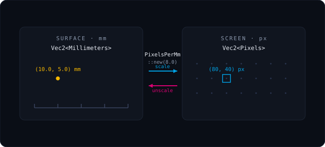

# Units

The `U` parameter of `Vec2<U, T>` / `Rect<U, T>` is a zero-cost phantom
marker — no runtime data, just a type-level tag that keeps coordinate
spaces apart. `Vec2<Millimeters>` and `Vec2<Pixels>` are different
types; you cannot silently add millimeters to pixels.

<figure class="diagram">
  
  <figcaption>PixelsPerMm bridges surface millimeters and screen pixels</figcaption>
</figure>

## The scalar units

| Unit | Meaning |
|---|---|
| `Millimeters` | physical surface distance — the canonical space for tabletop content |
| `Pixels<T>` | screen/buffer distance; generic over the backing scalar (`f64`, `f32`, `u32`, `i32`) |
| `SquareMillimeters` | area in mm² |
| `Degrees` | angle in degrees (human-facing: CLI args, config files) |
| `Radians` | angle in radians (math-facing) |
| `DegreesPerPixel` | angular velocity — e.g. flick-to-spin speeds |

```rust
use smearor_commons_geometry::{Degrees, Millimeters, Pixels};

let card_width = Millimeters::new(63.0);     // a poker card
let border = Pixels::new(2.0f64);            // a 2-px stroke
let tolerance = Degrees::new(5.0);           // snap tolerance
```

The newtypes wrap plain scalars (`serde(transparent)` on the wire) and
carry `as_raw`/`as_f64`/`as_f32` bridges plus `min`/`max`/`clamp`/
`abs` helpers where useful.

## Bridging spaces: PixelsPerMm & UnitsPerMm

`PixelsPerMm(pub f64)` is the scale between the physical surface and
the framebuffer — set once from DPI/surface calibration, then applied
everywhere:

```rust
use smearor_commons_geometry::{Millimeters, Pixels, PixelsPerMm, Vec2};

let scale = PixelsPerMm::new(8.0);

scale.scale(Millimeters::new(10.0));         // → Pixels(80.0)
scale.scale_vec(Vec2::<Millimeters>::new(10.0, 5.0)); // → Vec2<Pixels>(80, 40)

// the hit-testing direction: widget geometry → surface coordinates
scale.unscale(Pixels::new(80.0));            // → Millimeters(10.0)

// the hairline convention: never below the floor
scale.scale_at_least(Millimeters::new(0.05), Pixels::new(1.0)); // → Pixels(1.0)
```

`UnitsPerMm` does the same job for a *custom* game unit — e.g. "hexes
per millimeter" on a board that is neither mm nor px.

## Tagging and untagging vectors

`U` is a marker, not a value — `Vec2` offers `with_unit::<V>()` to
re-tag when crossing a boundary, and `x_unit()`/`y_unit()`/`splat()` to
manufacture unit values. The erased forms `Vec2<(), T>` (`Position`,
`Size`, `Rectangle` aliases) pick the unit up at the boundary:
`Vec2::from_mm(x, y)` and `Vec2::from_px(x, y)` construct tagged
vectors straight from unit scalars.
