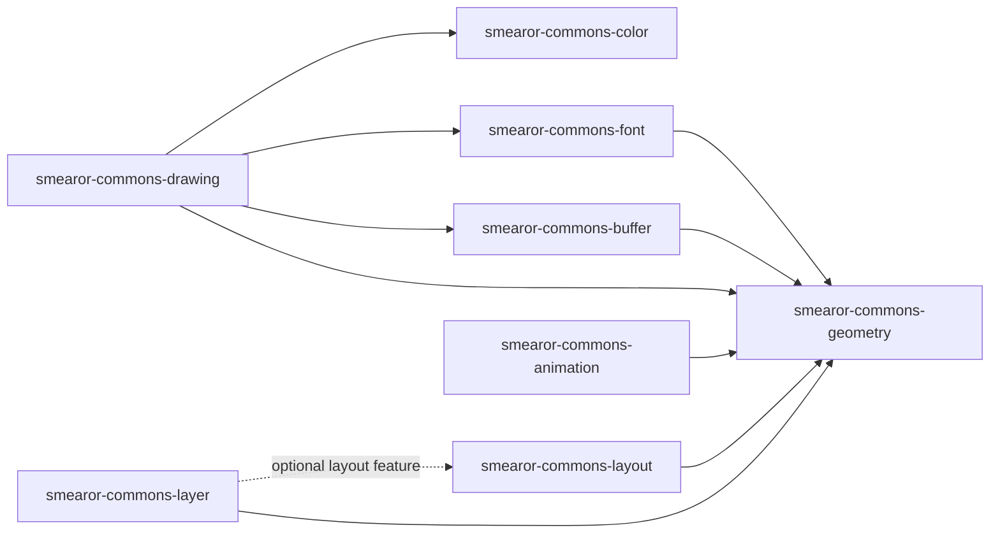

# Introduction

`smearor-commons` is a mono-workspace of small, framework-agnostic Rust
libraries shared across the Smearor ecosystem (table-top smart desk
frameworks, applications and games). All crates are published to
crates.io with a common version.

- `smearor-commons-geometry` — unit-tagged 2D vectors, rotations,
  rectangles and shapes. The foundation every other crate builds on.
- `smearor-commons-color` — channel-generic `Color<T>`, hex parsing,
  luminance operations and named palettes.
- `smearor-commons-font` — font metric helpers on `ab_glyph` fonts:
  scale fitting, bounds centering and text truncation.
- `smearor-commons-buffer` — format-tagged pixel buffers, strided
  views and metadata.
- `smearor-commons-drawing` — shared rendering vocabulary: primitives,
  icons, text and progress bars on pixel buffers (software raster) and
  cairo/GTK targets behind feature gates.
- `smearor-commons-animation` — `Interpolate`/`Trajectory`/
  `TimedAnimation` machinery with easing and a GTK4 frame-clock driver.
- `smearor-commons-layout` — headless tabletop layouting: `TableSide`/
  `Seat`, the `LayoutStrategy` trait, `FlowLayout` and `SeatLayout`.
- `smearor-commons-layer` — layer-shell vocabulary: `SmearorLayer`,
  `LayerConfig` and orientation-to-edge conversions.

## Dependency map

## Design

- **Pure `std` core** — no GUI or compositor dependencies by default.
- **Feature gates** — optional integrations (`async-graphql`,
  `schemars`, `zbus`, `evdev`, `gtk4`, `gtk4-layer-shell`, `cairo`,
  `smithay`) live behind features named after their dependency, so
  headless consumers pull no GUI libraries.
- **`serde` is unconditional.**
- **No domain semantics** — semantic newtypes (`FigureColor`,
  `BoardOrientation`, `CardPosition`, ...) stay in consumer crates as
  thin wrappers around the technical types provided here.
