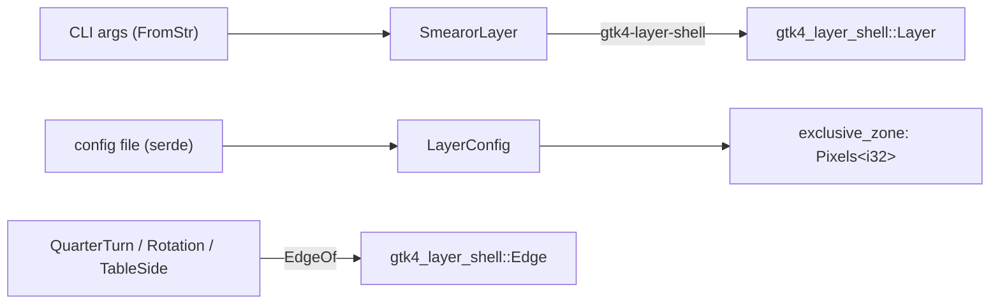

# smearor-commons-layer

Layer-shell vocabulary: `SmearorLayer` is the shared name for the four
layer-shell layers (`Background`, `Bottom`, `Top`, `Overlay`). It parses
from CLI arguments (`FromStr`), deserializes from configuration files
(`serde`) and converts into `gtk4_layer_shell::Layer` behind the
`gtk4-layer-shell` feature. `ParseLayerError` reports unknown names.

`LayerConfig` is the config quartet apps repeat across arguments, files
and state: `layer`, `namespace`, `monitor` and `exclusive_zone`
(`None` = auto-exclusive-zone, `0` = overlay mode).
`merge()` applies overrides; `effective_exclusive_zone()` resolves the
value to apply.

## Orientation to edge

With `gtk4-layer-shell` enabled, `EdgeOf` maps the snapped
four-orientation vocabularies — geometry's `QuarterTurn`/`Rotation` and,
behind the `layout` feature, layout's `TableSide` — onto the
layer-shell `Edge` a surface anchors to:

See the crate's rustdoc for the full API.
