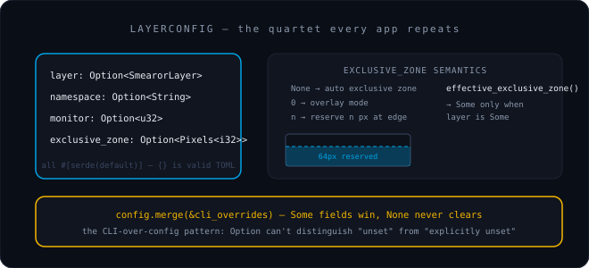

# LayerConfig

`LayerConfig` is the `layer`/`namespace`/`monitor`/`exclusive_zone`
quartet Smearor apps repeat across CLI arguments, configuration files
and runtime state. All fields are `Option` with `#[serde(default)]` —
an empty `{}` deserializes cleanly.

<figure class="diagram">
  
  <figcaption>exclusive zone reserves pixels at the anchor edge; 0 means overlay mode</figcaption>
</figure>

## The quartet

```rust
use smearor_commons_layer::{LayerConfig, SmearorLayer};
use smearor_commons_geometry::Pixels;

let config = LayerConfig {
    layer: Some(SmearorLayer::Overlay),   // None → compositor's default layer
    namespace: Some("smearor".into()),    // compositor window rules match on it
    monitor: Some(0),                     // None → primary monitor
    exclusive_zone: Some(Pixels::new(0)), // see below
};
```

Consumers needing extra fields wrap it with `#[serde(flatten)]` on a
`LayerConfig` member — the quartet rides inside their own config
struct.

## `exclusive_zone` semantics

| Value | Effect |
|---|---|
| `None` | auto exclusive zone — the compositor decides |
| `Some(0)` | overlay mode — reserve nothing, float above |
| `Some(n)` | reserve `n` pixels at the surface's anchor edge |

`i32`-backed because `gtk4_layer_shell` consumes `i32`; serde keeps
the bare-number wire format (`exclusive_zone = 64` in TOML).

## `effective_exclusive_zone()`

The zone only applies when a layer is selected — a surface on the
compositor's default layer is a regular window, not a layer surface:

```rust
LayerConfig { exclusive_zone: Some(Pixels::new(64)), ..Default::default() }
    .effective_exclusive_zone();                        // None — no layer set
```

## `merge()` — CLI over config

```rust
let effective = config.merge(&cli_args);
```

Every `Some` field in `overrides` replaces the local value; `None`
never clears — `Option` fields can't distinguish *"unset"* from
*"explicitly unset"*, so a CLI that doesn't mention `--monitor` keeps
the config file's monitor instead of wiping it. This is the
CLI-over-config pattern Smearor apps apply between their config file
and their argument parser.
