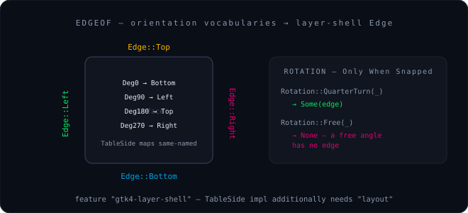

# Edges

`EdgeOf` — behind `gtk4-layer-shell` — maps the workspace's snapped
four-orientation vocabularies onto the `gtk4_layer_shell::Edge` a
layer surface anchors to. It replaces per-app match tables and
float-epsilon angle comparisons.

<figure class="diagram">
  
  <figcaption>each quarter turn names the edge its reading orientation faces</figcaption>
</figure>

```rust
pub trait EdgeOf {
    fn edge(self) -> Option<Edge>;
}
```

## `QuarterTurn` — always an edge

`Deg0` → `Bottom`, `Deg90` → `Left`, `Deg180` → `Top`, `Deg270` →
`Right`: the quarter turn a seated user faces *is* the edge their
surfaces anchor to — the same mapping `TableSide` expresses by name.

## `TableSide` — same-named edges

Behind the `layout` feature: `Bottom` → `Edge::Bottom`, `Left` →
`Edge::Left`, `Top` → `Edge::Top`, `Right` → `Edge::Right`. A seat
picked through layout vocabulary anchors its layer surface on the
matching compositor edge without translation tables.

## `Rotation` — only when snapped

`Rotation` is a union of `QuarterTurn` and `Free(RotationRad)`.
`edge()` delegates to `quarter_turn()`: snapped rotations return
`Some(edge)`, free angles return `None` — a `Rotation::Free(45°)` has
no edge to anchor to, and the type system makes that an explicit
decision rather than an epsilon bug.

```rust
use smearor_commons_layer::EdgeOf;
use smearor_commons_geometry::{Rotation, RotationRad, QuarterTurn};

Rotation::QuarterTurn(QuarterTurn::Deg270).edge();   // Some(Edge::Right)
Rotation::Free(RotationRad::from_degrees(45.0)).edge(); // None
```

## Feature gates

| Impl | Requires |
|---|---|
| `QuarterTurn` | `gtk4-layer-shell` |
| `Rotation` | `gtk4-layer-shell` |
| `TableSide` | `gtk4-layer-shell` + `layout` |

The `From<SmearorLayer> for Layer` conversion rides on the same
`gtk4-layer-shell` gate — the crate stays pure `std` + `serde`
without it.
