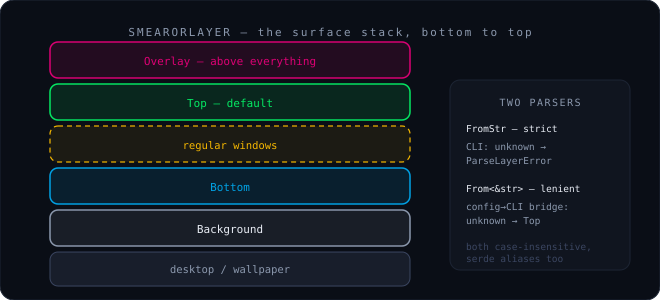

# Layers

`SmearorLayer` is the shared name for the four layer-shell layers —
the stack every Smearor surface lives in, from desktop background to
overlay.

<figure class="diagram">
  
  <figcaption>Top sits above regular windows — the default for Smearor surfaces</figcaption>
</figure>

## The four variants

```rust
use smearor_commons_layer::SmearorLayer;

SmearorLayer::Background;   // beneath everything, on the wallpaper level
SmearorLayer::Bottom;       // above background, beneath regular windows
SmearorLayer::Top;          // above regular windows — #[default]
SmearorLayer::Overlay;      // above everything else
```

## Two parsers, deliberately different

```rust
use std::str::FromStr;

// strict — CLI arguments: unknown names are an error
"overlay".parse::<SmearorLayer>();          // Ok(Overlay)
"OverLay".parse::<SmearorLayer>();          // Ok — case-insensitive
"mid".parse::<SmearorLayer>();              // Err(ParseLayerError { input: "mid" })

// lenient — the config→CLI bridge: unknown values must not fail
SmearorLayer::from("mid");                  // Top (the #[default] fallback)
```

`FromStr` rejects unknown input with `ParseLayerError` —
`"invalid layer '{input}': expected background, bottom, top or overlay"`.
`From<&str>` is the lenient counterpart used where a configuration
value feeds a CLI argument: it falls back to `Top` rather than fail.

Config files deserialize through `serde` with lowercase/Title/UPPER
aliases per variant — `layer = "overlay"` works in TOML regardless of
the author's capitalization habit.

## To the backend

Behind `gtk4-layer-shell`, `From<SmearorLayer> for
gtk4_layer_shell::Layer` converts one-to-one — `Background` →
`Layer::Background`, `Bottom` → `Layer::Bottom`, `Top` → `Layer::Top`,
`Overlay` → `Layer::Overlay`. The shared vocabulary never carries a
GTK dependency itself.
