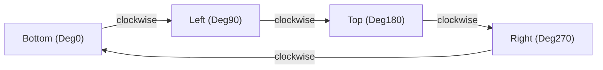
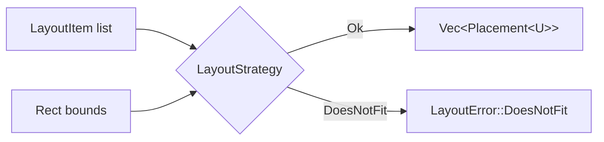

# smearor-commons-layout

Tabletop layout primitives — arrangement vocabulary without domain
semantics. Consumers map "player", "card" or "note" onto these
primitives; what a placed item *is* stays downstream. Everything is
unit-generic over the `U` marker of `Vec2`/`Rect`.

## What's inside

- [TableSides & Seats](./layout/seats.md) — `TableSide`, `Seat`,
  perimeter navigation, seat placement, `SeatPose`
- [Items & Placements](./layout/items.md) — `LayoutItem`,
  `Placement`, `footprint_for` axis swaps
- [Strategies](./layout/strategies.md) — `LayoutStrategy`,
  `FlowLayout`, `SeatLayout`, `EdgeStripLayout`, `OrbitLayout`,
  `AnchorWeights`, `DoesNotFit`
- [Workspace & View](./layout/view.md) — `WorkspaceSize`, the `View`
  camera, `physical_zoom`

## TableSide and Seat

`TableSide` names the four edges of a rectangular surface. Each side
defines the reading orientation of items placed in front of it:

- `TableSide::clockwise`/`counter_clockwise` step exhaustively;
  `TableSide::ALL` iterates for round-robin distribution.
- `TableSide::nearest(RotationRad)` snaps a free rotation to a side;
  `right_direction()`/`anchor_weights()` support edge math.

A `Seat` is a `TableSide` plus an optional edge `Fraction` offset
(`None` = let the strategy distribute). `perimeter_position()` orders
seats along the table perimeter (clockwise, `0.0..4.0`);
`next_in`/`previous_in` find the next occupied seat in a roster;
`placement()` positions a footprint in front of the seat;
`fanned_placement()` fills the free spot nearest the seat, reusing gaps
in the edge lane and allowing a lane behind the edge row.

## Strategies

A `LayoutStrategy` maps `LayoutItem`s onto `Placement`s
(center + rotation + footprint) inside `bounds` — index-stable, so
`placements[i]` answers `items[i]`:

- **`FlowLayout`** — non-overlapping anchored rows (`anchor`, `gap`),
  wrapping to the next line at the far edge.
- **`SeatLayout`** — explicit seats win;
  `SeatAssignment::RoundRobin` distributes the rest over
  `TableSide::ALL`.
- **`EdgeStripLayout`** — items as a strip *outside* the host bounds,
  docked to a `SideSet` of edges (`Sequential` or `Balanced`).
- **`OrbitLayout`** — items on an arc around the host center; anchored
  `OrbitItem`s pin their direction, flexible ones fill the gaps.

Overflow yields `LayoutError::DoesNotFit` — the consumer decides whether
to retry, shrink or leave items unarranged. `footprint_for` computes a
`Placement`'s displayed extent when an item changes orientation. See the
crate's rustdoc for the full API.
