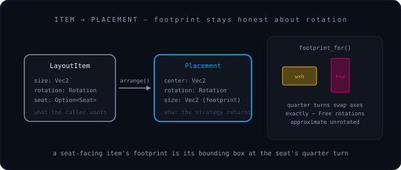

# Items & Placements

The two data structs on either side of `LayoutStrategy::arrange` —
what goes in, what comes out.

<figure class="diagram">
  
  <figcaption>index-stable: placements[i] answers items[i]</figcaption>
</figure>

## `LayoutItem` — the request

```rust
use smearor_commons_layout::{LayoutItem, Seat, TableSide};
use smearor_commons_geometry::{Rotation, RotationRad, Vec2};

let item = LayoutItem::new(
    Vec2::new(60.0, 40.0),            // footprint extent (rotated bbox)
    Rotation::Free(RotationRad::new(0.4)),
).with_seat(Seat::new(TableSide::Left));
```

- `size: Vec2` — the item's footprint **as currently rotated**
- `rotation: Rotation` — `QuarterTurn(_)` or `Free(_)`; strategies may
  preserve it (Flow) or override it (Seat)
- `seat: Option<Seat>` — explicit seat request; `None` leaves the
  decision to the strategy

## `Placement` — the answer

```rust
pub struct Placement<U, T = f64> {
    pub center: Vec2<U, T>,      // where inside bounds
    pub rotation: Rotation,      // orientation to render at
    pub size: Vec2<U, T>,        // footprint at that rotation
}
```

The `size` is the footprint *at the placement's own rotation* — a
seat-facing item rotated 90° reports `h×w`, not `w×h`.

## `footprint_for` — honest about quarter turns

```rust
use smearor_commons_layout::footprint_for;

footprint_for(Vec2::new(60.0, 40.0), rotation, QuarterTurn::Deg90);
// Vec2(40.0, 60.0) — quarter turns swap the axes exactly
```

Quarter turns are exact (`w×h` ↔ `h×w`); a `Free` source rotation
can't be inverted from its bounding box, so its footprint is
approximated as the unrotated extent. Strategies use this when an item
changes orientation on the way to its placement — a `SeatLayout`
placing an upright `60×40` item at the `Left` seat knows it occupies
`40×60` along the edge.
